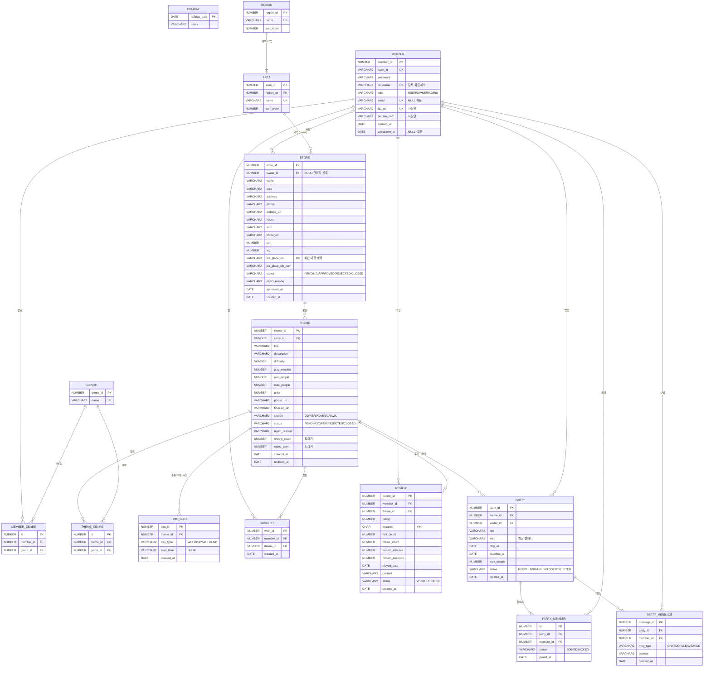
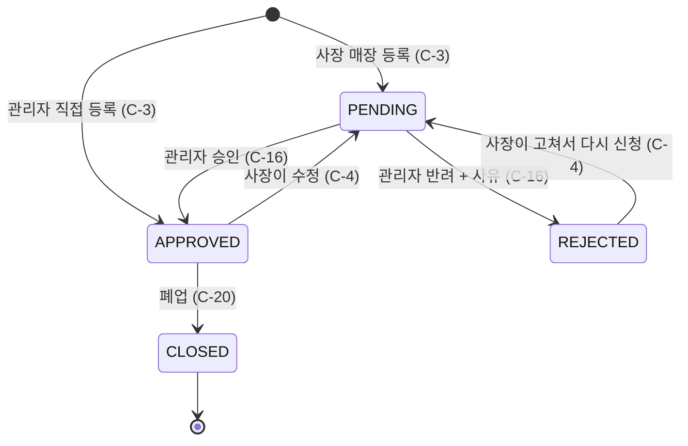
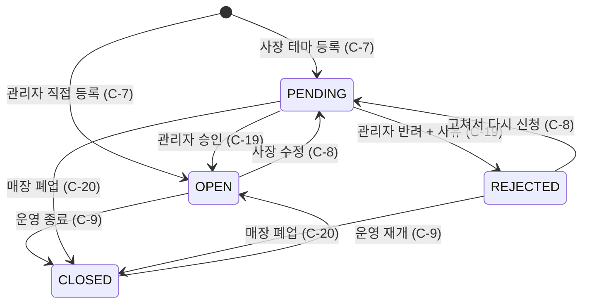
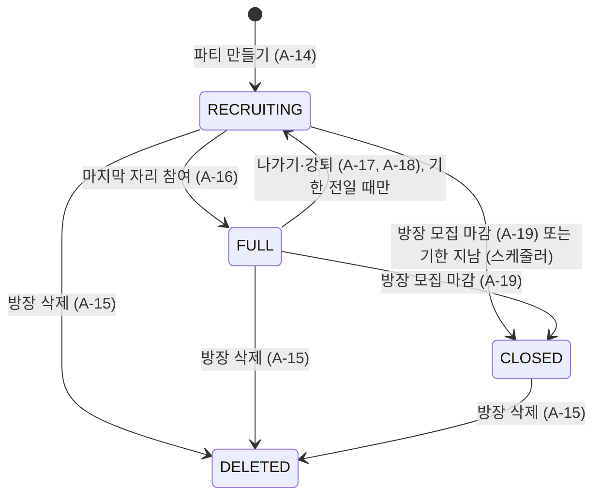

# Escaplix ERD (v3)

목업(`visualization/`) 구현 확정 기능과 **11/18 팀 결정**([8번 표](#8-확정된-결정-1118)) 반영 데이터 구조.

- 기준 자료: v1 SQL(14개 테이블), `노션_회의록_v2.md`, PM 미팅(11/17), 목업 v3 피드백 1~11번, 11/18 결정 21개
- DB: Oracle XE 11g, **서버 1개(모놀리식)**. `VARCHAR2` 크기는 **바이트** 단위(한글 1자 = 3바이트, `VARCHAR2(300)` = 한글 100자)
- DDL: 백엔드 레포 `src/main/resources/sql/create_tables.sql` (단일 관리). 더미 데이터는 같은 폴더 `insert_data.sql`
- API 명세: [`docs/API.md`](API.md)

> 표시: 추가 = 신규 · 변경 = 정의 변경 · 삭제 = 제거

---

## 1. 한눈에 보는 변경 (v1 → v3)

- 테이블 **15개**.
- BRAND·REPORT 삭제, HOLIDAY·REGION·AREA(지역) 추가.

| 테이블 | 담당 | 변경 내용 | 근거 |
| --- | --- | --- | --- |
| MEMBER | A | 삭제: `owner_type`, `status`(정지)<br>추가: `biz_no`(사업자등록번호), `biz_file_path`(사업자등록증)<br>추가(11/24): `email`, `withdrawn_at`. 닉네임 UNIQUE를 미탈퇴 회원 한정 인덱스로 변경 | 회의 v2-9, v3 피드백(사장 단일화, 가입 시 등록증), 이메일 인증·회원 탈퇴 |
| GENRE | C | 변경 없음 | |
| HOLIDAY (추가) | C | 공휴일 날짜. 공휴일은 **주말 시간표** 적용 | 결정 T1 |
| REGION (추가) | B | 큰 지역 코드 (서울·경기·인천…) | 결정 L1 |
| AREA (추가) | B | 세부 지역 코드 (홍대·강남…). STORE.`area`가 이 이름 참조 | 결정 L1 |
| BRAND (삭제) | — | 테이블 삭제 (브랜드 정보 미수집) | 결정 B1 |
| STORE | C | 삭제: `brand_id`<br>추가: `biz_place_no`, `biz_place_file_path`, `status`, `website_url`, `hours`, `intro`, `photo_url`, `reject_reason`, `approved_at`<br>변경: `phone`·`address` 필수, `area`는 AREA 등록 이름만(FK)<br>변경(11/24~25): `status`에 `CLOSED`(폐업), `biz_place_no` 사업장 관리번호 `VARCHAR2(14)`·폐업 제외 UNIQUE 인덱스, `intro` 선택 | 회의 v2-4·10, 결정 B2·S2·S4·S5·L1, 매장 폐업 |
| THEME | C | 추가: `updated_at`, `review_count`·`rating_sum`(트리거), `reject_reason`<br>변경: `source`에 `ADMIN` | 회의 v2-8, PM 미팅, 결정 S3·S4 |
| THEME_GENRE | C | 변경 없음 | |
| TIME_SLOT | C | 변경: 날짜별 칸 → **주중/주말 반복 시간표**(`day_type` + `start_time`)<br>삭제: `status` | v3 피드백 4, 결정 T2 |
| WISHLIST | B | 변경: `member_id` 실제 FK | 결정 D1 |
| REVIEW | D | 추가: `player_count`, `remain_minutes`(분)·`remain_seconds`(초 0~59)<br>삭제: `nickname` 복사본<br>변경: 실패 시 남은 시간 0 | 회의 v2-6, v3 피드백 5, 결정 D2·R2 |
| REPORT (삭제) | — | 테이블 삭제 (후기 신고 기능 제외, 11/23) | |
| MEMBER_GENRE | D | 변경: 가입 시점부터 저장 | 회의 v2-1 |
| PARTY | A | 추가: `intro`(방장 한마디), `deadline_at`(모집 기한)<br>변경: `status`에 `DELETED` | 회의 v2-5, 결정 P1 |
| PARTY_MEMBER | A | 추가: `status`(JOINED/KICKED)<br>삭제: `nickname` 복사본 | 결정 P2·D2 |
| PARTY_MESSAGE | A | 추가: `msg_type`(채팅/입장/퇴장/강퇴 안내)<br>삭제: `nickname` 복사본 | 결정 P3·D2 |

**서버 1개 확정에 따른 변경** (결정 D1·D2)

- 회원번호 컬럼 7개 전부 **실제 FK** (STORE.`owner_id`, WISHLIST·REVIEW·MEMBER_GENRE·PARTY_MEMBER·PARTY_MESSAGE.`member_id`, PARTY.`leader_id`).
- 닉네임 **복사본 컬럼 전부 삭제**. 닉네임 표시는 MEMBER JOIN.
- 닉네임 변경 시 후기·파티·채팅 전체에 즉시 반영.

**11/24 이후 DB 변경 (기존 DB 적용 순서)**

- 기존 DB: 백엔드 레포 `src/main/resources/sql/`의 파일을 아래 순서로 실행.
- 신규 DB: `create_tables.sql`에 반영 완료, 실행 불필요.

| 순서 | 파일 | 내용 |
| --- | --- | --- |
| 1 | `alter_member_email.sql` | MEMBER `email` 추가, `member_email_uk` |
| 2 | `alter_member_withdraw.sql` | MEMBER `withdrawn_at` 추가, 닉네임 UNIQUE 인덱스 변경, `member_owner_ck` 변경 |
| 3 | `alter_store_closed.sql` | STORE `status`에 `CLOSED`, `store_biz_place_uk`를 폐업 제외 인덱스로 변경 |
| 4 | `alter_store_form.sql` | STORE `biz_place_no` 12 → 14바이트, `intro` NULL 허용 |

- 이메일 인증번호는 서버 메모리 보관. 테이블 없음.

---

## 2. ERD 다이어그램



- HOLIDAY는 FK 관계 없음. 날짜의 주중/주말 판정 시에만 조회([3-7](#3-7-time_slot--주중주말-반복-시간표-c)).

---

## 3. 테이블 상세

- "필수" 칸 `Y` = NOT NULL.
- "규칙" 칸: PK/FK/UK/CHECK.

### 3-1. MEMBER — 회원 (A)

- 손님·사장·관리자를 `role` 하나로 구분.
- 사장은 가입 시 사업자등록번호·사업자등록증 사진 제출.
- 관리자 계정은 가입 불가, 더미 데이터로 생성.

| 컬럼 | 타입 | 필수 | 기본값 | 규칙 | 설명 | 변경 |
| --- | --- | :-: | --- | --- | --- | :-: |
| member_id | NUMBER | Y | | PK, `sq_member` | 회원번호 | |
| login_id | VARCHAR2(30) | Y | | UK | 영문·숫자 아이디 | |
| password | VARCHAR2(60) | Y | | | BCrypt 해시. 응답 포함 금지 | |
| nickname | VARCHAR2(60) | Y | | UNIQUE 인덱스 `member_nickname_uk` (탈퇴 회원 제외) | 한글 20자. 내 정보에서 변경 가능, 변경 시 전 화면 즉시 반영 | 변경 |
| role | VARCHAR2(10) | Y | | CHECK `USER`/`OWNER`/`ADMIN` | | |
| email | VARCHAR2(100) | | | UK `member_email_uk` | 소문자 저장. 가입 시 필수(서버 검사), 11/24 이전 가입 회원은 NULL. NULL 중복 허용 | 추가 |
| biz_no | VARCHAR2(12) | | | UK | 사업자등록번호 `123-45-67890`. **사장만** 필수 | 추가 |
| biz_file_path | VARCHAR2(500) | | | | 사업자등록증 경로(비공개 폴더). **사장만** 필수 | 추가 |
| created_at | DATE | Y | SYSDATE | | 가입일 | |
| withdrawn_at | DATE | | | | 탈퇴 일시. NULL = 미탈퇴 | 추가 |

**닉네임 UNIQUE 인덱스** (탈퇴 회원은 전부 "탈퇴한 회원"이므로 중복 검사 제외)

```sql
CREATE UNIQUE INDEX member_nickname_uk ON member (CASE WHEN withdrawn_at IS NULL THEN nickname END);
```

**CHECK `member_owner_ck`**: 사장은 두 값 모두 필수, 사장 외에는 둘 다 NULL. 탈퇴한 사장은 예외(탈퇴 시 둘 다 삭제).

```sql
(role = 'OWNER' AND (withdrawn_at IS NOT NULL OR (biz_no IS NOT NULL AND biz_file_path IS NOT NULL)))
OR (role <> 'OWNER' AND biz_no IS NULL AND biz_file_path IS NULL)
```

- 사장 계정 자체는 승인 절차 없음. 가입 즉시 로그인 가능. 매장 승인 전에는 사용 가능 기능 없음(결정 M1).

**탈퇴 처리 (API A-31)**: 행 삭제 없이 익명화.

| 컬럼 | 탈퇴 후 값 |
| --- | --- |
| login_id | `withdrawn#{member_id}` (가입 규칙상 재사용 불가 형식) |
| nickname | `탈퇴한 회원` (가입·닉네임 변경 시 사용 불가) |
| email, biz_no, biz_file_path | NULL |
| password | 임의 값의 BCrypt 해시 |
| withdrawn_at | 탈퇴 일시 |

- 후기·채팅은 FK 유지, "탈퇴한 회원"으로 표시.
- WISHLIST·MEMBER_GENRE 행 삭제. 미종료 파티는 방장이면 `DELETED`, 참여자면 PARTY_MEMBER 행 삭제.
- 매장 1개 이상 보유 사장(폐업 포함)·관리자는 탈퇴 불가.
- 동일 아이디·이메일·닉네임으로 재가입 가능.

### 3-2. GENRE — 장르 코드 (C)

| 컬럼 | 타입 | 필수 | 규칙 | 설명 |
| --- | --- | :-: | --- | --- |
| genre_id | NUMBER | Y | PK | |
| name | VARCHAR2(30) | Y | UK | 공포·추리·스릴러·감성·코믹·판타지·SF·모험 (더미 데이터 8개) |

### 3-3. HOLIDAY — 공휴일 (C) 추가

- 공휴일은 요일 무관 **주말(`WEEKEND`) 시간표** 적용(결정 T1).

| 컬럼 | 타입 | 필수 | 규칙 | 설명 |
| --- | --- | :-: | --- | --- |
| holiday_date | DATE | Y | PK, CHECK `holiday_date = TRUNC(holiday_date)` | 시각 없이 날짜만 |
| name | VARCHAR2(60) | Y | | 설날, 추석, 대체공휴일 … |

- 매년 **더미 데이터(INSERT)** 로 등록. 관리 화면·API 없음.
- 공휴일은 "토·일·공휴일 → `WEEKEND`, 나머지 → `WEEKDAY`" 규칙에 따라 주말 시간표 적용. 적용처: 시간표 조회(B-3), 날짜 필터(B-1), 파티 만들기(A-14).

### 3-3-1. REGION — 큰 지역 (B) 추가

| 컬럼 | 타입 | 필수 | 규칙 | 설명 |
| --- | --- | :-: | --- | --- |
| region_id | NUMBER | Y | PK | |
| name | VARCHAR2(30) | Y | UK | 서울, 경기, 인천, 충청, 경상, 전라, 강원, 제주 |
| sort_order | NUMBER(3) | Y | | 화면 표시 순서 (작을수록 앞) |

### 3-3-2. AREA — 세부 지역 (B) 추가

| 컬럼 | 타입 | 필수 | 규칙 | 설명 |
| --- | --- | :-: | --- | --- |
| area_id | NUMBER | Y | PK | |
| region_id | NUMBER | Y | FK → REGION | 소속 큰 지역 |
| name | VARCHAR2(30) | Y | UK | 홍대, 강남, 건대, 잠실 … (한글 10자) |
| sort_order | NUMBER(3) | Y | | 큰 지역 내 순서 |

- STORE.`area`에 **AREA.`name` 그대로** 저장(FK `store_area_fk`). 따라서 세부 지역 이름은 전체에서 중복 불가.
  - "중구"처럼 여러 지역에 있는 이름은 사용하지 않음.
  - 부산·대구 등 광역시는 큰 지역(경상)이 아닌 세부 지역 이름으로 등록.
- 번호(`area_id`) 대신 이름으로 연결한 이유: 기존 검색·목록 쿼리(`store.area = …`)와 화면 변경 회피.
- REGION·HOLIDAY와 동일하게 **더미 데이터(INSERT)** 로만 등록. 관리 화면 없음.
- 사용처: 매장 등록 화면 지역 select(B-12, 전체), 손님 검색 지역 칩(B-8, 매장 있는 지역만), 매장 등록·수정 검사(C-3·C-4).

### 3-4. STORE — 매장 (C)

- 사장 등록·수정 시 `PENDING`.
- 관리자가 사업장등록증 확인 후 승인 시 `APPROVED`, 이후 손님 화면 노출.
- 반려 시 `REJECTED`, 관리자 작성 사유를 사장에게 표시.
- 폐업 시 `CLOSED`. 복구 불가(11/24 추가, API C-20).

| 컬럼 | 타입 | 필수 | 기본값 | 규칙 | 설명 | 변경 |
| --- | --- | :-: | --- | --- | --- | :-: |
| store_id | NUMBER | Y | | PK | | |
| owner_id | NUMBER | | | FK → MEMBER | 등록한 사장. **관리자 직접 등록 시 NULL** | 변경 |
| name | VARCHAR2(150) | Y | | | 한글 50자 | |
| area | VARCHAR2(30) | Y | | FK → AREA(`name`) | 세부 지역 이름. 홍대/강남/건대/신촌… 필터·지역 칩 | 변경 |
| address | VARCHAR2(300) | Y | | | 공개 주소 | 변경(필수) |
| phone | VARCHAR2(20) | Y | | | 매장 전화 | 변경(필수) |
| website_url | VARCHAR2(500) | Y | | | **매장 웹사이트**. 매장 상세 "매장 웹사이트" 버튼. `http(s)://`로 시작 | 추가 |
| hours | VARCHAR2(150) | Y | | | 영업시간 한 줄 `10:00 ~ 23:00 (연중무휴)` | 추가 |
| intro | VARCHAR2(600) | | | | 매장 소개 (한글 200자). 선택(11/25 NOT NULL 해제) | 변경 |
| photo_url | VARCHAR2(500) | | | | **매장 사진** 경로(공개 폴더) `/uploads/stores/uuid.jpg`. 없으면 NULL | 추가 |
| lat / lng | NUMBER(9,6) | | | | 위도·경도 (지도, 선택 기능) | |
| biz_place_no | VARCHAR2(14) | Y | | UNIQUE 인덱스 `store_biz_place_uk` (폐업 매장 제외) | **사업장 관리번호** `000-00-00000-0` (사업자등록번호 10자리 + 1자리). 기존 더미는 10자리 | 변경 |
| biz_place_file_path | VARCHAR2(500) | | | | 사업장 증빙 서류 경로(비공개 폴더) | 추가 |
| status | VARCHAR2(10) | Y | `'PENDING'` | CHECK `PENDING`/`APPROVED`/`REJECTED`/`CLOSED` | 매장 승인 상태. `CLOSED` = 폐업 | 변경 |
| reject_reason | VARCHAR2(900) | | | | **반려 사유**. 관리자 작성, 사장에게 표시 (한글 300자) | 추가 |
| approved_at | DATE | | | CHECK `status <> 'APPROVED' OR approved_at IS NOT NULL` | **최초 승인 일시**. 손님 화면 매장 NEW(30일) 기준. 수정 후 재승인 시 미변경. 관리자 직접 등록은 등록 일시 | 추가 |
| created_at | DATE | Y | SYSDATE | | 신청일 | |
| ~~brand_id~~ | | | | | 브랜드 미수집 | 삭제 |

**CHECK 3개**

```sql
store_file_ck     : owner_id IS NULL OR biz_place_file_path IS NOT NULL   -- 사장이 등록하면 등록증 필수
store_reject_ck   : status <> 'REJECTED' OR reject_reason IS NOT NULL      -- 반려하면 사유 필수
store_approved_ck : status <> 'APPROVED' OR approved_at IS NOT NULL        -- 승인되면 승인일 필수
```

**사업장 관리번호 UNIQUE 인덱스**: 폐업 매장 번호는 NULL로 계산되어 제외. 동일 번호로 신규 매장 등록 가능.

```sql
CREATE UNIQUE INDEX store_biz_place_uk ON store (CASE WHEN status <> 'CLOSED' THEN biz_place_no END);
```

- 함수 기반 인덱스가 걸린 컬럼은 길이 변경 불가(ORA-30556). 길이 변경 시 인덱스 삭제 후 재생성(`alter_store_form.sql`).
- **수정 시 무조건 재승인 대기**(결정 S1). `APPROVED` 매장도 사장 수정 시 `PENDING`으로 복귀. 관리자 직접 등록·수정 매장은 즉시 `APPROVED`(결정 S3).
- 주의: 승인 매장 수정 시점부터 재승인 전까지 **해당 매장 테마 전체가 손님 화면에서 비노출**(손님 화면은 매장 APPROVED 테마만 표시). 사장 화면에서 수정 전 안내 필요.
- `PENDING` 복귀 시 `reject_reason` 초기화. 사장은 수정 중 이전 사유 확인 가능.
- **삭제 없음.** 테마·후기·파티가 매장을 참조하므로 `status`로만 관리.
- **폐업(`CLOSED`)**: `APPROVED` 매장만 가능. 폐업 시 해당 매장 테마 전체 `CLOSED`로 변경(단일 트랜잭션). 폐업 매장·테마는 수정 불가, 사장·관리자 화면에서 조회만 가능. 손님 화면 제외.

### 3-5. THEME — 테마 (C)

| 컬럼 | 타입 | 필수 | 기본값 | 규칙 | 설명 | 변경 |
| --- | --- | :-: | --- | --- | --- | :-: |
| theme_id | NUMBER | Y | | PK | | |
| store_id | NUMBER | Y | | FK → STORE | **APPROVED 매장만** 등록 가능(서버 검사) | |
| title | VARCHAR2(150) | Y | | | 한글 50자 | |
| description | VARCHAR2(4000) | | | | 소개 | |
| difficulty | NUMBER(1) | Y | | CHECK 1~5 | | |
| play_minutes | NUMBER(3) | Y | | CHECK > 0 | **제한 시간(분)** | |
| min_people / max_people | NUMBER(2) | Y | | CHECK 1 ≤ min ≤ max | | |
| price | NUMBER(7) | Y | | CHECK ≥ 0 | 1인 기준 가격(대표 가격). 인원별 가격 미저장. 정확한 가격은 매장 예약 페이지(`booking_url`) 확인 | |
| poster_url | VARCHAR2(500) | | | | 테마 사진 경로(공개 폴더) `/uploads/posters/uuid.jpg` | |
| booking_url | VARCHAR2(500) | Y | | | **해당 테마** 예약 링크. 테마 상세 "예약하러 가기" 버튼 | |
| source | VARCHAR2(10) | Y | `'OWNER'` | CHECK `OWNER`/`ADMIN`/`CRAWL` | | 변경(ADMIN) |
| status | VARCHAR2(10) | Y | `'PENDING'` | CHECK `PENDING`/`OPEN`/`REJECTED`/`CLOSED` | | |
| reject_reason | VARCHAR2(900) | | | CHECK `status <> 'REJECTED' OR reject_reason IS NOT NULL` | **반려 사유** | 추가 |
| review_count | NUMBER(6) | Y | 0 | | 노출 후기 수. **트리거** | 추가 |
| rating_sum | NUMBER(8) | Y | 0 | | 노출 후기 별점 합. **트리거**. 평균 = 합 / 수 | 추가 |
| created_at | DATE | Y | SYSDATE | | "새로 문을 연 테마" 줄 | |
| updated_at | DATE | Y | SYSDATE | | 내용 변경 시 **트리거**가 갱신 | 추가 |

- **JPA 주의**: `review_count`, `rating_sum`, `updated_at` 3개 컬럼은 `@Column(insertable = false, updatable = false)` 매핑. 자바에서 덮어쓰면 트리거 계산값 손상. `created_at`도 동일 매핑(DB 기본값 사용).
- 평균 별점: `CASE WHEN review_count = 0 THEN NULL ELSE ROUND(rating_sum / review_count, 1) END`.
- `PENDING` 복귀(수정 후 재신청) 시 `reject_reason` 초기화.

### 3-6. THEME_GENRE — 테마-장르 N:M (C)

| 컬럼 | 타입 | 필수 | 규칙 |
| --- | --- | :-: | --- |
| id | NUMBER | Y | PK |
| theme_id | NUMBER | Y | FK → THEME |
| genre_id | NUMBER | Y | FK → GENRE |
| | | | UK(theme_id, genre_id) |

- 테마 등록·수정 시 THEME·THEME_GENRE를 **단일 트랜잭션**으로 저장. 수정 시 기존 장르 삭제 후 재등록.

### 3-7. TIME_SLOT — 주중/주말 반복 시간표 (C)

- 사장은 "주중 시작 시간 목록"과 "주말 시작 시간 목록"만 등록. 매주 동일 적용.

| 컬럼 | 타입 | 필수 | 기본값 | 규칙 | 설명 | 변경 |
| --- | --- | :-: | --- | --- | --- | :-: |
| slot_id | NUMBER | Y | | PK | | |
| theme_id | NUMBER | Y | | FK → THEME | | |
| day_type | VARCHAR2(10) | Y | | CHECK `WEEKDAY`/`WEEKEND` | | 추가 |
| start_time | VARCHAR2(5) | Y | | CHECK `HH24:MI` 형식 | `19:00` | 추가 |
| created_at | DATE | Y | SYSDATE | | | 추가 |
| | | | | UK(theme_id, day_type, start_time) | | 변경 |
| ~~start_at~~, ~~status~~ | | | | | 날짜별 칸·회차 마감 삭제 (결정 T2) | 삭제 |

**날짜 → 날 유형 규칙** (서버 공통 함수 1개로 구현)

```
토요일, 일요일, 또는 HOLIDAY 에 있는 날짜  →  WEEKEND
그 밖의 날                                  →  WEEKDAY
```

- 종료 시각 미저장, `start_time + THEME.play_minutes`로 계산.
- 동일 날 유형 내 앞뒤 회차 간격은 `play_minutes` 이상. 서버 검사(C-11).

### 3-8. WISHLIST — 찜 (B)

| 컬럼 | 타입 | 필수 | 기본값 | 규칙 |
| --- | --- | :-: | --- | --- |
| wish_id | NUMBER | Y | | PK |
| member_id | NUMBER | Y | | FK → MEMBER |
| theme_id | NUMBER | Y | | FK → THEME |
| created_at | DATE | Y | SYSDATE | 찜한 날 (최근순) |
| | | | | UK(member_id, theme_id) → 중복 시 409 |

### 3-9. REVIEW — 후기 (D)

| 컬럼 | 타입 | 필수 | 기본값 | 규칙 | 설명 | 변경 |
| --- | --- | :-: | --- | --- | --- | :-: |
| review_id | NUMBER | Y | | PK | | |
| member_id | NUMBER | Y | | FK → MEMBER | 작성자. 닉네임은 JOIN | 변경(FK) |
| theme_id | NUMBER | Y | | FK → THEME | | |
| rating | NUMBER(1) | Y | | CHECK 1~5 | | |
| escaped | CHAR(1) | Y | | CHECK `Y`/`N` | 탈출 성공 여부 | |
| hint_count | NUMBER(2) | Y | 0 | CHECK ≥ 0 | | |
| player_count | NUMBER(2) | Y | | CHECK ≥ 1 | 플레이 인원 | 추가 |
| remain_minutes | NUMBER(3) | Y | 0 | CHECK ≥ 0 (`review_min_ck`) | 남은 시간 **분** (3분 47초 → 3). **실패 시 0** | 추가 |
| remain_seconds | NUMBER(2) | Y | 0 | CHECK 0~59 (`review_sec_ck`) | 남은 시간 **초** (3분 47초 → 47). **실패 시 0** | 추가 |
| | | | | CHECK `escaped = 'Y' OR (remain_minutes = 0 AND remain_seconds = 0)` (`review_fail_ck`) | 실패 후기는 분·초 모두 0 | |
| played_date | DATE | Y | TRUNC(SYSDATE) | | 플레이 날짜. **미입력 시 작성일** | 변경 |
| content | VARCHAR2(600) | | | | 한 줄 후기 (한글 200자) | |
| status | VARCHAR2(10) | Y | `'VISIBLE'` | CHECK `VISIBLE`/`HIDDEN` | 숨김은 관리자 처리용(추후 기능) | |
| created_at | DATE | Y | SYSDATE | | | |
| ~~nickname~~ | | | | | 복사본 삭제 → JOIN | 삭제 |
| | | | | UK(member_id, theme_id) | 테마당 후기 1개 → 409 | |

- 남은 시간 상한(`분 × 60 + 초 ≤ play_minutes × 60`)은 서버 검사.
- 화면 표시는 분·초를 `mm:ss`로 결합(예: 12분 34초 → `12:34`).
- 초기 설계는 초 단일 컬럼(`remain_seconds`, 3분 47초 = 227). 화면 입력이 분·초 2칸이므로 DB도 2칸으로 분리.

### 3-10. ~~REPORT~~ — 삭제 (11/23)

- 후기 신고 기능 제외에 따라 테이블 삭제.
- 타 문서 링크 보존을 위해 번호 유지.
- `create_tables.sql`에는 기존 DB 정리용 `DROP TABLE report`·`DROP SEQUENCE sq_report`만 잔존.

### 3-11. MEMBER_GENRE — 선호 장르 N:M (D)

| 컬럼 | 타입 | 필수 | 규칙 |
| --- | --- | :-: | --- |
| id | NUMBER | Y | PK |
| member_id | NUMBER | Y | FK → MEMBER (손님만) |
| genre_id | NUMBER | Y | FK → GENRE |
| | | | UK(member_id, genre_id) |

- 손님 가입(A-1) 시 MEMBER와 **단일 트랜잭션**으로 최초 저장.
- 수정: 내 정보 탭(D-8).
- 맞춤 추천(D-9) 기준.

### 3-12. PARTY — 파티 모집 글 (A)

| 컬럼 | 타입 | 필수 | 기본값 | 규칙 | 설명 | 변경 |
| --- | --- | :-: | --- | --- | --- | :-: |
| party_id | NUMBER | Y | | PK | | |
| theme_id | NUMBER | Y | | FK → THEME | OPEN 테마만 | |
| leader_id | NUMBER | Y | | FK → MEMBER | 방장 | 변경(FK) |
| title | VARCHAR2(300) | Y | | | 한글 100자 | |
| intro | VARCHAR2(300) | Y | | | **방장 한마디** 한글 100자. 목록 배너·파티 방 상단 | 추가 |
| play_at | DATE | Y | | | 날짜+시각. 해당 날 유형(주중/주말) 시간표에 있는 시각 | |
| deadline_at | DATE | Y | | CHECK deadline_at ≤ play_at | **모집 기한** | 추가 |
| max_people | NUMBER(2) | Y | | CHECK ≥ 2 | 방장 포함. 테마 인원 범위 내 | |
| status | VARCHAR2(12) | Y | `'RECRUITING'` | CHECK `RECRUITING`/`FULL`/`CLOSED`/`DELETED` | | 변경(DELETED) |
| created_at | DATE | Y | SYSDATE | | | |

- **현재 인원** = PARTY_MEMBER 중 `status = 'JOINED'` 행 수. 별도 저장 컬럼 없음.
- **삭제는 물리 삭제 없이** `status = 'DELETED'`로 변경(결정 P1). 참여자·채팅 기록 유지.
- `DELETED` 파티는 **전 화면 비노출**(목록, 방, 내 채팅). 접근 시 404.
- 파티 목록 조건: `status IN ('RECRUITING', 'FULL')`, 기한 전, 테마 `OPEN`, 매장 `APPROVED` (11/23·11/25 변경).
- 기한 경과 `RECRUITING`·`FULL` 파티는 스케줄러가 `CLOSED`로 변경([5-3](#5-3-모집-기한-자동-마감-스케줄러)).
- `play_at` 경과 파티는 채팅 읽기 전용(저장 컬럼 없음, 요청 시 계산).

### 3-13. PARTY_MEMBER — 파티 참여자 (A)

| 컬럼 | 타입 | 필수 | 기본값 | 규칙 | 설명 | 변경 |
| --- | --- | :-: | --- | --- | --- | :-: |
| id | NUMBER | Y | | PK | | |
| party_id | NUMBER | Y | | FK → PARTY | | |
| member_id | NUMBER | Y | | FK → MEMBER | 닉네임은 JOIN | 변경(FK) |
| status | VARCHAR2(10) | Y | `'JOINED'` | CHECK `JOINED`/`KICKED` | 참여 중 / 강퇴 | 추가 |
| joined_at | DATE | Y | SYSDATE | | | |
| ~~nickname~~ | | | | | 복사본 삭제 | 삭제 |
| | | | | UK(party_id, member_id) | | |

| 동작 | DB 처리 | 재참여 |
| --- | --- | --- |
| 파티 만들기 | 방장 행을 `JOINED`로 INSERT | — |
| 참여 | `JOINED` 행 INSERT | — |
| **나가기** | 행 **DELETE** | 가능 (신규 행 INSERT) |
| **강퇴** | 행 유지, `status = 'KICKED'`로 변경 | **불가** (결정 P2). 기존 행으로 UK 위반 → 409 |

- 인원 계산·참여자 목록·채팅 권한·내 채팅 목록은 모두 **`JOINED`만** 대상.

### 3-14. PARTY_MESSAGE — 파티 채팅 (A)

| 컬럼 | 타입 | 필수 | 기본값 | 규칙 | 설명 | 변경 |
| --- | --- | :-: | --- | --- | --- | :-: |
| message_id | NUMBER | Y | | PK | `?after=` 기준(단조 증가) | |
| party_id | NUMBER | Y | | FK → PARTY | | |
| member_id | NUMBER | Y | | FK → MEMBER | 보낸 사람 / 안내 줄이면 대상자 | 변경(FK) |
| msg_type | VARCHAR2(10) | Y | `'CHAT'` | CHECK `CHAT`/`JOIN`/`LEAVE`/`KICK` | 일반 채팅 / 안내 줄 | 추가 |
| content | VARCHAR2(1500) | | | CHECK `msg_type <> 'CHAT' OR content IS NOT NULL` | 한글 500자. 안내 줄은 NULL | 변경 |
| created_at | DATE | Y | SYSDATE | | | |
| ~~nickname~~ | | | | | 복사본 삭제 | 삭제 |

- **안내 줄**: 채팅방 중앙에 표시되는 입장·퇴장·강퇴 안내.
- 안내 줄은 **DB 저장 방식**(결정 P3). 파티 만들기·참여·나가기·강퇴 API에서 **동일 트랜잭션**으로 1행 INSERT.

---

## 4. 상태값과 바뀌는 흐름

### 4-1. STORE.status



- `CLOSED`에서 다른 상태로의 전이 없음.

### 4-2. THEME.status



- 매장 폐업으로 `CLOSED`된 테마는 운영 재개 불가(매장 수정 차단).
- 손님 화면(목록·상세·검색·추천·매장)은 **`THEME.status = 'OPEN'` 및 `STORE.status = 'APPROVED'` 테마만** 표시.

### 4-3. PARTY.status



### 4-4. 그 밖의 상태값

| 컬럼 | 값 | 이번 범위 내 변경 지점 |
| --- | --- | --- |
| PARTY_MEMBER.status | JOINED / KICKED | 강퇴(A-18) 시 KICKED |
| REVIEW.status | VISIBLE / HIDDEN | 없음. 숨김은 관리자 처리(추후 기능) |
| MEMBER.role | USER / OWNER / ADMIN | 가입(A-1, A-2) 시 확정, 이후 불변 |
| MEMBER.withdrawn_at | NULL / 일시 | 탈퇴(A-31) 시 기록. 복구 없음 |

---

## 5. DB와 서버가 자동으로 처리하는 것

### 5-1. 후기 → 테마 별점 집계 (트리거)

- 트리거 `trg_review_theme_stats` (REVIEW `AFTER INSERT OR DELETE OR UPDATE OF rating, status`).
- 후기 등록·별점 수정·숨김·삭제 시 THEME `review_count`·`rating_sum` 자동 갱신. 숨김(`HIDDEN`) 후기 제외.
- 트리거는 THEME만 수정, REVIEW 재조회 없음 → ORA-04091(mutating table) 미발생.
- 전제: 후기 `theme_id` 변경 불가(D-2).

### 5-2. 테마 수정일 (트리거)

- 트리거 `trg_theme_updated_at` (THEME `BEFORE UPDATE`).
- THEME **내용 컬럼** 변경 시에만 `updated_at` 갱신. 대상: `store_id`, `title`, `description`, `difficulty`, `play_minutes`, `min_people`, `max_people`, `price`, `poster_url`, `booking_url`, `status`.
- 별점 집계(`review_count`, `rating_sum`)로는 미갱신.

### 5-3. 모집 기한 자동 마감 (스케줄러)

- Spring `@Scheduled`, 매일 03:00(Asia/Seoul) 실행(A 담당, 11/23 변경). `PartyDeadlineScheduler`.

```sql
UPDATE party SET status = 'CLOSED'
 WHERE status IN ('RECRUITING', 'FULL') AND deadline_at <= SYSDATE
```

- 정원 마감(`FULL`) 파티도 기한 경과 시 `CLOSED`.
- 실행 전까지는 목록·참여 API가 `deadline_at > SYSDATE` 직접 검사, 응답 상태도 `CLOSED`로 표시.

---

## 6. 파일(이미지) 저장 규칙

| 종류 | 업로드 지점 | 저장 폴더 | 공개 | 경로 컬럼 |
| --- | --- | --- | --- | --- |
| 테마 사진 | 테마 등록·수정 (C-7, C-8) | `uploads/posters/` | **공개** `/uploads/posters/**` | THEME.poster_url |
| 매장 사진 (추가) | 매장 등록·수정 (C-3, C-4) | `uploads/stores/` | **공개** `/uploads/stores/**` | STORE.photo_url |
| 사업자등록증 | 사장 가입 (A-2) | `private/biz/` | **비공개**, 관리자 API(A-11)로만 | MEMBER.biz_file_path |
| 사업장 증빙 서류 | 매장 등록·수정 (C-3, C-4) | `private/biz-place/` | **비공개**, 관리자 API(C-15)로만 | STORE.biz_place_file_path |

- DB에는 파일이 아닌 **경로만** 저장.
- 허용 형식 jpg·png·webp, 5MB 이하. 확장자 외 실제 파일 형식(시그니처)도 확인.
- 저장 파일명은 `UUID.확장자`로 신규 생성.
- 사업자등록증·사업장등록증은 개인정보이므로 **공개 폴더 저장 금지**.
- **더미 데이터 사진**: 백엔드 레포 `src/main/resources/uploads/posters/`(테마), `…/uploads/stores/`(매장), git 관리 대상.
  - 동일 주소(`/uploads/posters/{파일}`, `/uploads/stores/{파일}`) 요청 시 실행 폴더 `uploads/`(업로드 사진) 우선 조회, 없으면 더미 폴더 조회.
  - 실행 폴더 `uploads/`는 실행 중 생성 파일이므로 git 제외(`.gitignore`의 `/uploads/`).
  - 사진 출처(Pexels 작가 목록): `uploads/posters/credits.csv`.
- 테마·매장 사진은 **백엔드에서만** 관리. 프런트 레포에는 테마·매장 사진 미보관(결정 S5).

---

## 7. 더미 데이터

- 파일: 백엔드 레포 `src/main/resources/sql/insert_data.sql` (v1 `02_dummy_data.sql` 대체).
- `create_tables.sql` 실행 직후 빈 테이블 기준으로 실행. 전 계정 비밀번호 `1234`(BCrypt).
- PK는 숫자 직접 지정, 파일 끝에서 시퀀스를 `MAX(id)+1`부터 재생성.
- 파티 날짜는 `SYSDATE` 기준(실행 시점과 무관하게 향후 파티로 생성).
- 파일 끝에 확인용 쿼리 포함(테이블별 행 수, 트리거 집계 기대값, 파티 현재 인원).

| 테이블 | 행 수 | 내용 |
| --- | --- | --- |
| MEMBER | 10 | 관리자 `admin`, 사장 `owner1`~`owner3`(`biz_no`·`biz_file_path` 포함), 손님 `user1`~`user6`. `email` 미입력(NULL). 본사·정지 계정 없음 |
| GENRE | 8 | 공포·추리·스릴러·감성·코믹·판타지·SF·모험 |
| REGION / AREA | 8 / 35 | **STORE보다 먼저** INSERT(FK) |
| HOLIDAY | 25 | 2026년 잔여 공휴일 + 2027년 전체(대체공휴일 포함) |
| STORE | 6 | `APPROVED` 4(사장 3 + 관리자 직접 등록 1, `owner_id` NULL), `PENDING` 1, `REJECTED` 1(사유 포함). 전부 `website_url`·`hours`·`intro`·`biz_place_no`(기존 10자리 형식) 포함. `area`는 홍대·강남·건대·신촌. `photo_url`은 `/uploads/stores/common-0N.jpg` |
| THEME | 10 | `OPEN` 7, `CLOSED` 1(`CRAWL`), `PENDING` 1, `REJECTED` 1(사유 포함). `source`는 `OWNER`·`ADMIN`·`CRAWL` 모두 포함. `poster_url`은 `/uploads/posters/{장르}-NN.jpg` |
| THEME_GENRE | 15 | |
| TIME_SLOT | 70 | `OPEN` 테마 7개 × (`WEEKDAY` 15·17·19·21시 4개 + `WEEKEND` 11·13·15·17·19·21시 6개). 17·19·21시는 주중·주말 공통 → 파티 시각으로 사용 |
| MEMBER_GENRE | 12 | 손님만 |
| WISHLIST | 8 | |
| REVIEW | 14 | `VISIBLE` 13, `HIDDEN` 1. `player_count`·`remain_minutes`·`remain_seconds` 포함, 실패 후기는 분·초 0. **트리거 생성 후** INSERT해야 THEME 별점 집계 |
| PARTY | 5 | `RECRUITING` 2, `FULL` 1, `CLOSED` 1(기한·플레이 시각 경과), `DELETED` 1. `intro`·`deadline_at` 포함 |
| PARTY_MEMBER | 11 | 방장 포함. 3번 파티에 `KICKED` 1행(재참여 409 테스트) |
| PARTY_MESSAGE | 13 | `CHAT`과 안내 줄(`JOIN`·`KICK`) 혼합 |

- 미포함 항목(테스트 필요 시 직접 INSERT): 11월 평일 임시 공휴일(주말 시간표 전환 확인용), 기한 경과 `RECRUITING` 파티(스케줄러 테스트용), `CLOSED` 매장, `LEAVE` 안내 줄, 탈퇴 회원.
- 크롤링 데이터: 같은 폴더 `crawl_data.sql`(자동 생성, `insert_data.sql` 다음 실행, 재실행 가능). 매장은 `owner_id` NULL·`APPROVED`, 테마는 `source = 'CRAWL'`·`OPEN`, 포스터는 외부 사이트 사진 주소.

---

## 8. 확정된 결정 (11/18)

| 번호 | 질문 | 결정 | 반영 위치 |
| --- | --- | --- | --- |
| D1 | 서버 1개 / 2개 | **서버 1개, 모놀리식** | 회원 컬럼 전부 FK, API 서버 주소 1개 |
| D2 | 닉네임 변경 시 기록도 변경? | **전부 변경** | 닉네임 복사본 컬럼 삭제, JOIN으로 표시 |
| M1 | 사장 계정도 승인? | **매장만 승인** | MEMBER에 상태 컬럼 없음 |
| B1 | 브랜드 | **브랜드 정보 미수집** | BRAND 테이블·`brand_id`·브랜드 API 삭제 |
| B2 | 매장 상세 링크 | **매장 웹사이트로 직접 연결** | STORE.`website_url` |
| S1 | 승인된 매장 수정 | **재승인 대기** | C-4, 상태 흐름 4-1 |
| S2 | 매장 영업시간·소개 | **매장 등록 화면에 입력 칸 추가(필수)** | STORE.`hours` NOT NULL, `intro`(11/25 선택으로 변경), C-3 |
| S3 | 관리자 직접 등록 | **즉시 공개** | 매장 APPROVED, 테마 OPEN·`source = ADMIN` |
| S4 | 반려 사유 | **관리자 작성, 사업자에게 전달** | `reject_reason`(매장·테마), C-16·C-19 |
| T1 | 공휴일 | **주말 시간표 적용** | HOLIDAY 테이블, 날 유형 규칙 |
| T2 | 날짜·회차별 마감 | **없음** | TIME_SLOT에 상태 없음 |
| R1 | 후기 플레이 날짜 | **선택 입력, 미입력 시 작성일** | `played_date` 기본값 |
| R2 | 실패 후기 남은 시간 | **0으로 저장** (분·초 모두) | CHECK `review_fail_ck` |
| ~~R3~~ | ~~신고 사유~~ | 신고 기능 제외로 폐기 (11/23) | |
| P1 | 파티 삭제 | **물리 삭제 없음, status로 관리** | PARTY.status `DELETED` |
| P2 | 강퇴자 재참여 | **불가** | PARTY_MEMBER.status `KICKED` |
| P3 | 채팅 안내 줄 | **DB 저장 방식** | PARTY_MESSAGE.`msg_type` |
| C1 | 비회원 추천 영역 | **이번 주 인기 OPEN 테마 5개 (B-1 sort=popular)**. 초기 평점순 → C2로 변경 | API D-9 설명 |
| C2 | 인기 테마 기준 | **최근 7일 신규 파티×3 + 신규 찜×2 + 신규 후기×1** (동점 시 평점순). 누적 아닌 7일 집계 | API B-1 `sort=popular`·`weeklyScore` (WISHLIST·PARTY·REVIEW의 `created_at` 사용) |
| L1 | 매장 지역 | **직접 입력 대신 목록 선택. 큰 지역(REGION) → 세부 지역(AREA) 2단계** | REGION·AREA 테이블, STORE.`area` FK, B-8·B-12, C-3·C-4 |
| S5 | 사진 관리 위치 / 매장 사진 | **테마·매장 사진 모두 백엔드 관리. 매장 사진도 수집(선택)** | STORE.`photo_url`, C-3·C-4 `storePhoto`, B-9·B-10·C-1·C-14 `photoUrl`, 6번 저장 규칙 |
