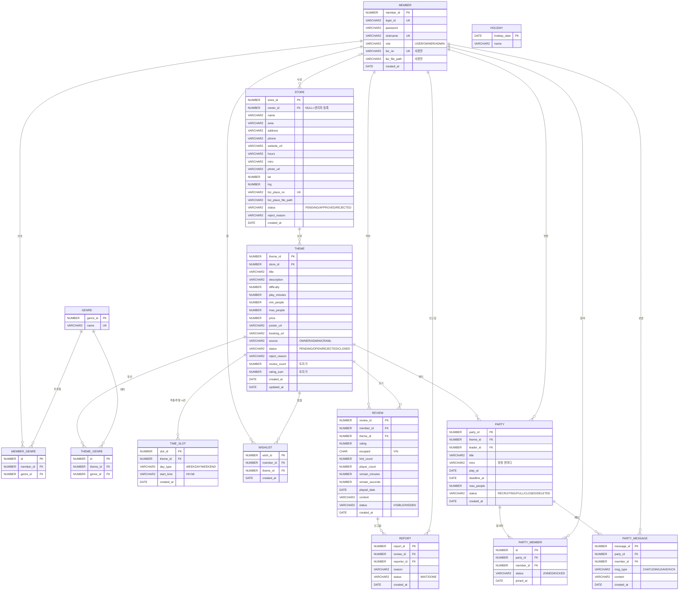
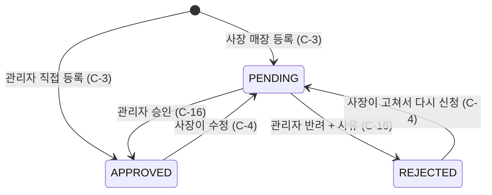
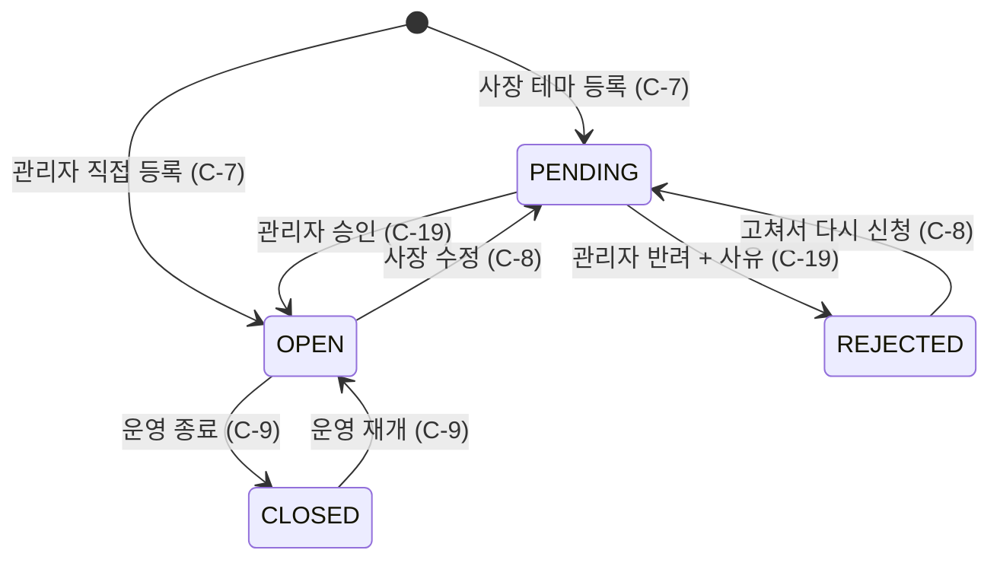
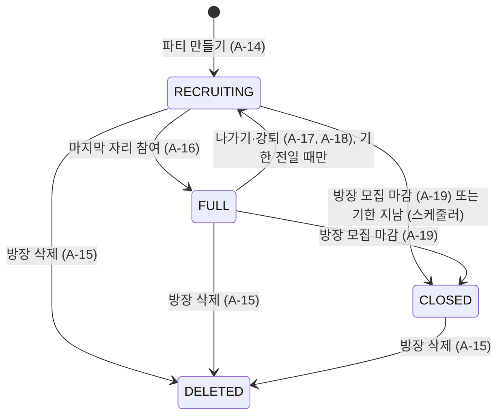

# Escaplix ERD (v3)

목업(`visualization/`)에서 구현하기로 정한 기능과 **11/18 팀 결정**([8번 표](#8-확정된-결정-1118))을 반영한 데이터 구조입니다.

- 기준 자료: v1 SQL(14개 테이블), `노션_회의록_v2.md`, PM 미팅(11/17), 목업 v3 피드백 1~11번, 11/18 결정 19개
- DB: Oracle XE 11g, **서버 1개(모놀리식)**. `VARCHAR2` 크기는 **바이트** 단위입니다. 한글 1글자가 3바이트라서 `VARCHAR2(300)`에는 한글 100자가 들어갑니다.
- DDL: [`docs/create_tables.sql`](create_tables.sql). 백엔드 레포 `sql/create_tables.sql`과 내용이 같습니다.
- API 명세: [`docs/API.md`](API.md)

> 표시: 🆕 새로 생김 · ✏️ 바뀜 · 🗑️ 없앰

---

## 1. 한눈에 보는 변경 (v1 → v3)

테이블은 **14개**입니다. BRAND를 없애고 HOLIDAY를 새로 만들었습니다.

| 테이블 | 담당 | 바뀐 내용 | 근거 |
| --- | --- | --- | --- |
| MEMBER | A | 🗑️ `owner_type`, 🗑️ `status`(정지)<br>🆕 `biz_no`(사업자등록번호), 🆕 `biz_file_path`(사업자등록증) | 회의 v2-9, v3 피드백(사장 하나로, 가입 때 등록증) |
| GENRE | C | 그대로 | |
| 🆕 HOLIDAY | C | 공휴일 날짜. 공휴일은 **주말 시간표**로 봄 | 결정 T1 |
| 🗑️ BRAND | — | 테이블 삭제 (브랜드 정보를 받지 않음) | 결정 B1 |
| STORE | C | 🗑️ `brand_id`<br>🆕 `biz_place_no`, `biz_place_file_path`, `status`, `website_url`, `hours`, `intro`, `photo_url`, `reject_reason`<br>✏️ `phone`·`address` 필수 | 회의 v2-4·10, 결정 B2·S2·S4·S5 |
| THEME | C | 🆕 `updated_at`, `review_count`·`rating_sum`(트리거), `reject_reason`<br>✏️ `source`에 `ADMIN` | 회의 v2-8, PM 미팅, 결정 S3·S4 |
| THEME_GENRE | C | 그대로 | |
| TIME_SLOT | C | ✏️ 날짜별 칸 → **주중/주말 반복 시간표**(`day_type` + `start_time`)<br>🗑️ `status` | v3 피드백 4, 결정 T2 |
| WISHLIST | B | ✏️ `member_id`가 진짜 FK | 결정 D1 |
| REVIEW | D | 🆕 `player_count`, `remain_minutes`(분)·`remain_seconds`(초 0~59)<br>🗑️ `nickname` 복사본<br>✏️ 실패면 남은 시간 0 | 회의 v2-6, v3 피드백 5, 결정 D2·R2 |
| REPORT | D | ✏️ 사유는 자유 글만 | 결정 R3 |
| MEMBER_GENRE | D | ✏️ 가입 때부터 들어감 | 회의 v2-1 |
| PARTY | A | 🆕 `intro`(방장 한마디), `deadline_at`(모집 기한)<br>✏️ `status`에 `DELETED` | 회의 v2-5, 결정 P1 |
| PARTY_MEMBER | A | 🆕 `status`(JOINED/KICKED)<br>🗑️ `nickname` 복사본 | 결정 P2·D2 |
| PARTY_MESSAGE | A | 🆕 `msg_type`(채팅/입장/퇴장/강퇴 안내)<br>🗑️ `nickname` 복사본 | 결정 P3·D2 |

**서버 1개로 정해지면서 바뀐 것** (결정 D1·D2)

- 회원번호를 담는 컬럼 8개가 모두 **진짜 FK**가 됩니다.
- 닉네임 **복사본 컬럼을 모두 없앴습니다.** 화면에 닉네임이 필요하면 MEMBER와 JOIN합니다.
- 그래서 닉네임을 바꾸면 후기·파티·채팅 어디서나 바로 새 닉네임으로 보입니다.

---

## 2. ERD 다이어그램



HOLIDAY는 다른 테이블과 FK로 이어지지 않습니다. 날짜가 주중인지 주말인지 정할 때만 조회합니다([3-7](#3-7-time_slot--주중주말-반복-시간표-c)).

---

## 3. 테이블 상세

표의 "필수" 칸에 ✔가 있으면 NOT NULL입니다. "규칙" 칸에는 PK/FK/UK/CHECK를 적었습니다.

### 3-1. MEMBER — 회원 (A)

손님·사장·관리자를 `role` 하나로 나눕니다.
- 사장은 가입할 때 사업자등록번호와 사업자등록증 사진을 냅니다.
- 관리자 계정은 가입으로 만들 수 없고, 더미 데이터로 넣습니다.

| 컬럼 | 타입 | 필수 | 기본값 | 규칙 | 설명 | 변경 |
| --- | --- | :-: | --- | --- | --- | :-: |
| member_id | NUMBER | ✔ | | PK, `sq_member` | 회원번호 | |
| login_id | VARCHAR2(30) | ✔ | | UK | 영문·숫자 아이디 | |
| password | VARCHAR2(60) | ✔ | | | BCrypt 해시. 응답에 절대 넣지 않음 | |
| nickname | VARCHAR2(60) | ✔ | | UK | 한글 20자. 내 정보에서 바꿀 수 있고, 바꾸면 모든 화면에 바로 반영 | |
| role | VARCHAR2(10) | ✔ | | CHECK `USER`/`OWNER`/`ADMIN` | | |
| biz_no | VARCHAR2(12) | | | UK | 사업자등록번호 `123-45-67890`. **사장만** 필수 | 🆕 |
| biz_file_path | VARCHAR2(500) | | | | 사업자등록증 경로(비공개 폴더). **사장만** 필수 | 🆕 |
| created_at | DATE | ✔ | SYSDATE | | 가입일 | |

**CHECK `member_owner_ck`**: 사장이면 두 값이 모두 있어야 하고, 사장이 아니면 둘 다 비어 있어야 합니다.

```sql
(role = 'OWNER' AND biz_no IS NOT NULL AND biz_file_path IS NOT NULL)
OR (role <> 'OWNER' AND biz_no IS NULL AND biz_file_path IS NULL)
```

- 사장 계정 자체는 승인받지 않습니다. 가입하면 바로 로그인할 수 있습니다. 매장을 등록해서 승인받기 전에는 할 수 있는 일이 없습니다(결정 M1).

### 3-2. GENRE — 장르 코드 (C)

| 컬럼 | 타입 | 필수 | 규칙 | 설명 |
| --- | --- | :-: | --- | --- |
| genre_id | NUMBER | ✔ | PK | |
| name | VARCHAR2(30) | ✔ | UK | 공포·추리·감성·코믹·어드벤처·SF·잠입 (더미로 넣음) |

### 3-3. HOLIDAY — 공휴일 (C) 🆕

공휴일은 요일과 상관없이 **주말(`WEEKEND`) 시간표**로 봅니다(결정 T1).

| 컬럼 | 타입 | 필수 | 규칙 | 설명 |
| --- | --- | :-: | --- | --- |
| holiday_date | DATE | ✔ | PK, CHECK `holiday_date = TRUNC(holiday_date)` | 시각 없이 날짜만 |
| name | VARCHAR2(60) | ✔ | | 설날, 추석, 대체공휴일 … |

- 해마다 **더미 데이터(INSERT)** 로 넣습니다. 관리 화면과 API는 없습니다.
- 날짜가 공휴일이면 "토·일·공휴일 → `WEEKEND`, 나머지 → `WEEKDAY`" 규칙에 따라 주말 시간표를 씁니다. 이 규칙을 쓰는 곳은 시간표 조회(B-3), 날짜 필터(B-1), 파티 만들기(A-14)입니다.

### 3-4. STORE — 매장 (C)

- 사장이 등록하거나 수정하면 `PENDING`이 됩니다.
- 관리자가 사업장등록증을 확인하고 승인하면 `APPROVED`가 되고, 그때부터 손님에게 보입니다.
- 반려하면 `REJECTED`가 되고, 관리자가 쓴 사유가 사장에게 보입니다.

| 컬럼 | 타입 | 필수 | 기본값 | 규칙 | 설명 | 변경 |
| --- | --- | :-: | --- | --- | --- | :-: |
| store_id | NUMBER | ✔ | | PK | | |
| owner_id | NUMBER | | | FK → MEMBER | 등록한 사장. **관리자가 직접 등록하면 NULL** | ✏️ |
| name | VARCHAR2(150) | ✔ | | | 한글 50자 | |
| area | VARCHAR2(30) | ✔ | | | 홍대/강남/건대/신촌… 필터·지역 칩 | |
| address | VARCHAR2(300) | ✔ | | | 공개 주소 | ✏️ 필수 |
| phone | VARCHAR2(20) | ✔ | | | 매장 전화 | ✏️ 필수 |
| website_url | VARCHAR2(500) | ✔ | | | **매장 웹사이트**. 매장 상세 "매장 웹사이트 ↗" 버튼. `http(s)://`로 시작 | 🆕 |
| hours | VARCHAR2(150) | ✔ | | | 영업시간 한 줄 `10:00 ~ 23:00 (연중무휴)` | 🆕 |
| intro | VARCHAR2(600) | ✔ | | | 매장 소개 (한글 200자) | 🆕 |
| photo_url | VARCHAR2(500) | | | | **매장 사진** 경로(공개 폴더) `/uploads/stores/uuid.jpg`. 없으면 NULL | 🆕 |
| lat / lng | NUMBER(9,6) | | | | 위도·경도 (지도, 선택 기능) | |
| biz_place_no | VARCHAR2(12) | ✔ | | UK | 사업장 등록번호. 매장마다 하나 | 🆕 |
| biz_place_file_path | VARCHAR2(500) | | | | 사업장등록증 경로(비공개 폴더) | 🆕 |
| status | VARCHAR2(10) | ✔ | `'PENDING'` | CHECK `PENDING`/`APPROVED`/`REJECTED` | 매장 승인 상태 | 🆕 |
| reject_reason | VARCHAR2(900) | | | | **반려 사유**. 관리자가 쓰고 사장에게 보임 (한글 300자) | 🆕 |
| created_at | DATE | ✔ | SYSDATE | | 신청일 | |
| ~~brand_id~~ | | | | | 브랜드 받지 않음 | 🗑️ |

**CHECK 두 개**

```sql
store_file_ck   : owner_id IS NULL OR biz_place_file_path IS NOT NULL   -- 사장이 등록하면 등록증 필수
store_reject_ck : status <> 'REJECTED' OR reject_reason IS NOT NULL      -- 반려하면 사유 필수
```

- **수정하면 무조건 다시 승인 대기**입니다(결정 S1). 이미 `APPROVED`인 매장을 사장이 고쳐도 `PENDING`으로 돌아갑니다. 관리자가 직접 등록·수정한 매장은 바로 `APPROVED`입니다(결정 S3).
- ⚠️ 그 결과, 승인된 매장을 수정하는 순간 **그 매장의 테마들도 손님 화면에서 사라졌다가** 다시 승인되면 돌아옵니다. 손님 화면에는 매장이 APPROVED인 테마만 보이기 때문이에요. 사장 화면에서 수정하기 전에 이 점을 안내해야 합니다.
- 다시 `PENDING`이 될 때 `reject_reason`은 비웁니다. 사장은 고치는 동안에는 이전 사유를 볼 수 있습니다.
- **삭제하지 않습니다.** 테마·후기·파티가 매장을 참조하기 때문에 `status`로만 관리합니다.

### 3-5. THEME — 테마 (C)

| 컬럼 | 타입 | 필수 | 기본값 | 규칙 | 설명 | 변경 |
| --- | --- | :-: | --- | --- | --- | :-: |
| theme_id | NUMBER | ✔ | | PK | | |
| store_id | NUMBER | ✔ | | FK → STORE | **APPROVED 매장만** 등록 가능(서버 검사) | |
| title | VARCHAR2(150) | ✔ | | | 한글 50자 | |
| description | VARCHAR2(4000) | | | | 소개 | |
| difficulty | NUMBER(1) | ✔ | | CHECK 1~5 | | |
| play_minutes | NUMBER(3) | ✔ | | CHECK > 0 | **제한 시간(분)** | |
| min_people / max_people | NUMBER(2) | ✔ | | CHECK 1 ≤ min ≤ max | | |
| price | NUMBER(7) | ✔ | | CHECK ≥ 0 | 1인 가격. 인원과 상관없이 고정 | |
| poster_url | VARCHAR2(500) | | | | 테마 사진 경로(공개 폴더) `/uploads/posters/uuid.jpg` | |
| booking_url | VARCHAR2(500) | ✔ | | | **이 테마**의 예약 링크. 테마 상세 "예약하러 가기" 버튼 | |
| source | VARCHAR2(10) | ✔ | `'OWNER'` | CHECK `OWNER`/`ADMIN`/`CRAWL` | | ✏️ ADMIN |
| status | VARCHAR2(10) | ✔ | `'PENDING'` | CHECK `PENDING`/`OPEN`/`REJECTED`/`CLOSED` | | |
| reject_reason | VARCHAR2(900) | | | CHECK `status <> 'REJECTED' OR reject_reason IS NOT NULL` | **반려 사유** | 🆕 |
| review_count | NUMBER(6) | ✔ | 0 | | 보이는 후기 수. **트리거** | 🆕 |
| rating_sum | NUMBER(8) | ✔ | 0 | | 보이는 후기 별점 합. **트리거**. 평균 = 합 / 수 | 🆕 |
| created_at | DATE | ✔ | SYSDATE | | "새로 문을 연 테마" 줄 | |
| updated_at | DATE | ✔ | SYSDATE | | 내용이 바뀔 때 **트리거**가 갱신 | 🆕 |

- **JPA 주의**: `review_count`, `rating_sum`, `updated_at` 세 컬럼은 `@Column(insertable = false, updatable = false)`로 매핑합니다. 자바가 값을 덮어쓰면 트리거가 계산한 값이 망가집니다.
- 평균 별점은 `CASE WHEN review_count = 0 THEN NULL ELSE ROUND(rating_sum / review_count, 1) END`로 구합니다.
- 다시 `PENDING`이 될 때(수정해서 다시 신청) `reject_reason`을 비웁니다.

### 3-6. THEME_GENRE — 테마-장르 N:M (C)

| 컬럼 | 타입 | 필수 | 규칙 |
| --- | --- | :-: | --- |
| id | NUMBER | ✔ | PK |
| theme_id | NUMBER | ✔ | FK → THEME |
| genre_id | NUMBER | ✔ | FK → GENRE |
| | | | UK(theme_id, genre_id) |

테마를 등록·수정할 때 THEME과 THEME_GENRE를 **한 트랜잭션**으로 저장합니다. 수정할 때는 기존 장르를 지우고 다시 넣습니다.

### 3-7. TIME_SLOT — 주중/주말 반복 시간표 (C)

사장은 "주중 시작 시간들"과 "주말 시작 시간들"만 등록합니다. 이 시간표가 매주 똑같이 쓰입니다.

| 컬럼 | 타입 | 필수 | 기본값 | 규칙 | 설명 | 변경 |
| --- | --- | :-: | --- | --- | --- | :-: |
| slot_id | NUMBER | ✔ | | PK | | |
| theme_id | NUMBER | ✔ | | FK → THEME | | |
| day_type | VARCHAR2(10) | ✔ | | CHECK `WEEKDAY`/`WEEKEND` | | 🆕 |
| start_time | VARCHAR2(5) | ✔ | | CHECK `HH24:MI` 형식 | `19:00` | 🆕 |
| created_at | DATE | ✔ | SYSDATE | | | 🆕 |
| | | | | UK(theme_id, day_type, start_time) | | ✏️ |
| ~~start_at~~, ~~status~~ | | | | | 날짜별 칸·회차 마감 없앰 (결정 T2) | 🗑️ |

**날짜 → 날 유형 규칙** (서버 공통 함수 하나로 만들어 쓰세요)

```
토요일, 일요일, 또는 HOLIDAY 에 있는 날짜  →  WEEKEND
그 밖의 날                                  →  WEEKDAY
```

- 종료 시각은 저장하지 않고 `start_time + THEME.play_minutes`로 계산합니다.
- 같은 날 유형 안에서 앞뒤 회차 간격이 `play_minutes`보다 짧으면 안 됩니다. 이 검사는 서버가 합니다(C-11).

### 3-8. WISHLIST — 찜 (B)

| 컬럼 | 타입 | 필수 | 기본값 | 규칙 |
| --- | --- | :-: | --- | --- |
| wish_id | NUMBER | ✔ | | PK |
| member_id | NUMBER | ✔ | | FK → MEMBER |
| theme_id | NUMBER | ✔ | | FK → THEME |
| created_at | DATE | ✔ | SYSDATE | 찜한 날 (최근순) |
| | | | | UK(member_id, theme_id) → 중복이면 409 |

### 3-9. REVIEW — 후기 (D)

| 컬럼 | 타입 | 필수 | 기본값 | 규칙 | 설명 | 변경 |
| --- | --- | :-: | --- | --- | --- | :-: |
| review_id | NUMBER | ✔ | | PK | | |
| member_id | NUMBER | ✔ | | FK → MEMBER | 작성자. 닉네임은 JOIN | ✏️ FK |
| theme_id | NUMBER | ✔ | | FK → THEME | | |
| rating | NUMBER(1) | ✔ | | CHECK 1~5 | | |
| escaped | CHAR(1) | ✔ | | CHECK `Y`/`N` | 탈출 성공 | |
| hint_count | NUMBER(2) | ✔ | 0 | CHECK ≥ 0 | | |
| player_count | NUMBER(2) | ✔ | | CHECK ≥ 1 | 몇 명이서 | 🆕 |
| remain_minutes | NUMBER(3) | ✔ | 0 | CHECK ≥ 0 | 남은 시간 **분**. 3분 47초면 3. **실패면 0** | 🆕 |
| remain_seconds | NUMBER(2) | ✔ | 0 | CHECK 0~59, CHECK `escaped = 'Y' OR (remain_minutes = 0 AND remain_seconds = 0)` | 남은 시간 **초**. 3분 47초면 47. **실패면 0** | 🆕 |
| played_date | DATE | ✔ | TRUNC(SYSDATE) | | 플레이한 날. **비우면 작성일** | ✏️ |
| content | VARCHAR2(600) | | | | 한 줄 후기 (한글 200자) | |
| status | VARCHAR2(10) | ✔ | `'VISIBLE'` | CHECK `VISIBLE`/`HIDDEN` | 숨김은 신고 처리용(이번 범위 밖) | |
| created_at | DATE | ✔ | SYSDATE | | | |
| ~~nickname~~ | | | | | 복사본 없앰 → JOIN | 🗑️ |
| | | | | UK(member_id, theme_id) | 한 테마에 후기 하나 → 409 | |

- 남은 시간은 분·초 두 칸으로 저장합니다. 위쪽 한계(`remain_minutes × 60 + remain_seconds ≤ play_minutes × 60`)는 서버가 검사합니다.
- 화면에서는 `mm:ss`로 보여 줍니다.

### 3-10. REPORT — 후기 신고 (D)

| 컬럼 | 타입 | 필수 | 기본값 | 규칙 | 설명 |
| --- | --- | :-: | --- | --- | --- |
| report_id | NUMBER | ✔ | | PK | |
| review_id | NUMBER | ✔ | | FK → REVIEW | |
| reporter_id | NUMBER | ✔ | | FK → MEMBER | 신고한 사람 |
| reason | VARCHAR2(900) | ✔ | | | **자유 글 사유만** (한글 300자). 유형은 받지 않음 |
| status | VARCHAR2(10) | ✔ | `'WAIT'` | CHECK `WAIT`/`DONE` | |
| created_at | DATE | ✔ | SYSDATE | | |
| | | | | UK(review_id, reporter_id) | 같은 후기 두 번 신고 → 409 |

이번 범위는 **접수까지**입니다. 관리자 처리 화면은 나중 기능입니다.

### 3-11. MEMBER_GENRE — 선호 장르 N:M (D)

| 컬럼 | 타입 | 필수 | 규칙 |
| --- | --- | :-: | --- |
| id | NUMBER | ✔ | PK |
| member_id | NUMBER | ✔ | FK → MEMBER (손님만) |
| genre_id | NUMBER | ✔ | FK → GENRE |
| | | | UK(member_id, genre_id) |

- 손님 가입(A-1) 때 MEMBER와 **같은 트랜잭션**으로 처음 넣습니다.
- 수정은 내 정보 탭(D-8)에서 합니다.
- 맞춤 추천(D-9)의 기준이 됩니다.

### 3-12. PARTY — 파티 모집 글 (A)

| 컬럼 | 타입 | 필수 | 기본값 | 규칙 | 설명 | 변경 |
| --- | --- | :-: | --- | --- | --- | :-: |
| party_id | NUMBER | ✔ | | PK | | |
| theme_id | NUMBER | ✔ | | FK → THEME | OPEN 테마만 | |
| leader_id | NUMBER | ✔ | | FK → MEMBER | 방장 | ✏️ FK |
| title | VARCHAR2(300) | ✔ | | | 한글 100자 | |
| intro | VARCHAR2(300) | ✔ | | | **방장 한마디** 한글 100자. 목록 배너·파티 방 위쪽 | 🆕 |
| play_at | DATE | ✔ | | | 날짜+시각. 그날 유형(주중/주말) 시간표에 있는 시각 | |
| deadline_at | DATE | ✔ | | CHECK deadline_at ≤ play_at | **모집 기한** | 🆕 |
| max_people | NUMBER(2) | ✔ | | CHECK ≥ 2 | 방장 포함. 테마 인원 범위 안 | |
| status | VARCHAR2(12) | ✔ | `'RECRUITING'` | CHECK `RECRUITING`/`FULL`/`CLOSED`/`DELETED` | | ✏️ DELETED |
| created_at | DATE | ✔ | SYSDATE | | | |

- **현재 인원** = PARTY_MEMBER 가운데 `status = 'JOINED'`인 줄 수입니다. 따로 저장하는 컬럼은 없습니다.
- **삭제는 실제로 지우지 않고** `status = 'DELETED'`로 바꿉니다(결정 P1). 참여자와 채팅 기록은 그대로 남습니다.
- `DELETED` 파티는 **모든 화면에서 숨깁니다**: 목록, 방, 내 채팅. 접근하면 404입니다.
- 파티 목록에는 `RECRUITING`이면서 기한이 지나지 않은 파티만 나옵니다.
- 기한이 지난 `RECRUITING` 파티는 스케줄러가 `CLOSED`로 바꿉니다([5-3](#5-3-모집-기한-자동-마감-스케줄러)).

### 3-13. PARTY_MEMBER — 파티 참여자 (A)

| 컬럼 | 타입 | 필수 | 기본값 | 규칙 | 설명 | 변경 |
| --- | --- | :-: | --- | --- | --- | :-: |
| id | NUMBER | ✔ | | PK | | |
| party_id | NUMBER | ✔ | | FK → PARTY | | |
| member_id | NUMBER | ✔ | | FK → MEMBER | 닉네임은 JOIN | ✏️ FK |
| status | VARCHAR2(10) | ✔ | `'JOINED'` | CHECK `JOINED`/`KICKED` | 참여 중 / 강퇴됨 | 🆕 |
| joined_at | DATE | ✔ | SYSDATE | | | |
| ~~nickname~~ | | | | | 복사본 없앰 | 🗑️ |
| | | | | UK(party_id, member_id) | | |

| 일 | DB에서 하는 일 | 다시 참여할 수 있나 |
| --- | --- | --- |
| 파티 만들기 | 방장 줄을 `JOINED`로 넣음 | — |
| 참여 | `JOINED` 줄을 넣음 | — |
| **나가기** | 줄을 **지움** | 가능 (새 줄을 넣으면 됨) |
| **강퇴** | 줄을 지우지 않고 `status = 'KICKED'`로 바꿈 | **불가** (결정 P2). 이미 줄이 있어서 UK에 걸림 → 409 |

인원 계산, 참여자 목록, 채팅 권한, 내 채팅 목록은 모두 **`JOINED`만** 봅니다.

### 3-14. PARTY_MESSAGE — 파티 채팅 (A)

| 컬럼 | 타입 | 필수 | 기본값 | 규칙 | 설명 | 변경 |
| --- | --- | :-: | --- | --- | --- | :-: |
| message_id | NUMBER | ✔ | | PK | `?after=` 기준(늘어나기만 함) | |
| party_id | NUMBER | ✔ | | FK → PARTY | | |
| member_id | NUMBER | ✔ | | FK → MEMBER | 보낸 사람 / 안내 줄이면 그 대상 | ✏️ FK |
| msg_type | VARCHAR2(10) | ✔ | `'CHAT'` | CHECK `CHAT`/`JOIN`/`LEAVE`/`KICK` | 일반 채팅 / 안내 줄 | 🆕 |
| content | VARCHAR2(1500) | | | CHECK `msg_type <> 'CHAT' OR content IS NOT NULL` | 한글 500자. 안내 줄은 NULL | ✏️ |
| created_at | DATE | ✔ | SYSDATE | | | |
| ~~nickname~~ | | | | | 복사본 없앰 | 🗑️ |

- **안내 줄**은 채팅방 가운데에 뜨는 "○○님이 들어왔어요 / 나갔어요 / 강퇴됐어요" 같은 줄입니다.
- 안내 줄은 **저장해서 씁니다**(결정 P3). 파티 만들기·참여·나가기·강퇴 API 안에서 **같은 트랜잭션**으로 한 줄을 넣습니다.

---

## 4. 상태값과 바뀌는 흐름

### 4-1. STORE.status



### 4-2. THEME.status



손님 화면(목록·상세·검색·추천·매장)에는 **`THEME.status = 'OPEN'`이고 `STORE.status = 'APPROVED'`인 테마만** 나옵니다.

### 4-3. PARTY.status



### 4-4. 그 밖의 상태값

| 컬럼 | 값 | 이번 범위에서 바뀌는 곳 |
| --- | --- | --- |
| PARTY_MEMBER.status | JOINED / KICKED | 강퇴(A-18)하면 KICKED |
| REVIEW.status | VISIBLE / HIDDEN | 없음. 숨김은 신고 처리(나중 기능) |
| REPORT.status | WAIT / DONE | 접수(D-11) 때 WAIT. DONE은 나중 기능 |
| MEMBER.role | USER / OWNER / ADMIN | 가입(A-1, A-2) 때 정해지고 바뀌지 않음 |

---

## 5. DB와 서버가 자동으로 처리하는 것

### 5-1. 후기 → 테마 별점 집계 (트리거)

- 후기를 넣거나, 별점을 고치거나, 숨기거나, 지우면 THEME의 `review_count`와 `rating_sum`이 자동으로 바뀝니다. 숨김(`HIDDEN`) 후기는 빠집니다.
- 트리거는 THEME만 고치고 REVIEW를 다시 읽지 않습니다. 그래서 ORA-04091(mutating table) 오류가 나지 않습니다.
- 전제: 후기의 `theme_id`는 바꿀 수 없습니다(D-2).

### 5-2. 테마 수정일 (트리거)

- THEME의 **내용 컬럼**이 바뀔 때만 `updated_at`이 바뀝니다.
- 별점 집계(`review_count`, `rating_sum`)로는 바뀌지 않습니다.

### 5-3. 모집 기한 자동 마감 (스케줄러)

Spring `@Scheduled`로 5분마다 실행합니다(A 담당).

```sql
UPDATE party SET status = 'CLOSED'
 WHERE status = 'RECRUITING' AND deadline_at <= SYSDATE
```

스케줄러가 돌기 전 몇 분 사이에도 기한이 지난 파티가 보이면 안 됩니다. 그래서 목록 API와 참여 API도 `deadline_at > SYSDATE`를 직접 검사합니다.

---

## 6. 파일(이미지) 저장 규칙

| 종류 | 올리는 곳 | 저장 폴더 | 공개 | 경로 컬럼 |
| --- | --- | --- | --- | --- |
| 테마 사진 | 테마 등록·수정 (C-7, C-8) | `uploads/posters/` | **공개** `/uploads/posters/**` | THEME.poster_url |
| 매장 사진 🆕 | 매장 등록·수정 (C-3, C-4) | `uploads/stores/` | **공개** `/uploads/stores/**` | STORE.photo_url |
| 사업자등록증 | 사장 가입 (A-2) | `private/biz/` | **비공개**, 관리자 API(A-11)로만 | MEMBER.biz_file_path |
| 사업장등록증 | 매장 등록·수정 (C-3, C-4) | `private/biz-place/` | **비공개**, 관리자 API(C-15)로만 | STORE.biz_place_file_path |

- DB에는 파일이 아니라 **경로만** 저장합니다.
- 받는 형식은 jpg·png·webp이고 5MB 이하만 받습니다. 확장자만 보지 말고 실제 파일 형식도 확인합니다.
- 저장할 때 파일 이름은 `UUID.확장자`로 새로 짓습니다.
- 사업자등록증·사업장등록증은 개인정보라서 **공개 폴더에 두지 않습니다.**
- **더미 데이터 사진**은 백엔드 레포 `src/main/resources/uploads/posters/`(테마), `…/uploads/stores/`(매장)에 있고 git에 올라가 있습니다.
  - 서버는 같은 주소(`/uploads/posters/{파일}`, `/uploads/stores/{파일}`)로 요청이 오면 실행 폴더의 `uploads/`(올린 사진)를 먼저 찾고, 없으면 더미 폴더에서 찾습니다.
  - 실행 폴더의 `uploads/`는 실행 중에 생기는 파일이라 git에 올리지 않습니다(`.gitignore`의 `/uploads/`).
  - 사진 출처(Pexels 작가 목록)는 `uploads/posters/credits.csv`에 있습니다.
- 테마·매장 사진은 **백엔드에서만** 관리합니다. 프런트 레포에는 테마·매장 사진을 두지 않습니다(결정 S5).

---

## 7. 더미 데이터에 넣을 것

v3 구조에 맞춰 새로 만들 때 아래를 꼭 넣어 주세요. 팀이 v1의 `02_dummy_data.sql`을 지웠으므로 새 파일이 필요합니다.

- **회원**
  - 관리자 `admin`
  - 사장 `owner1`·`owner2`: `biz_no`, `biz_file_path` 포함
  - 손님 `user1`~`user4`
  - 본사·정지 계정은 없습니다.
- **HOLIDAY**: 올해와 내년 공휴일. 테스트용으로 11월 평일 하루를 임시 공휴일로 넣어 두면 주말 시간표로 바뀌는지 확인하기 좋습니다.
- **STORE**
  - 상태별로 하나 이상: `APPROVED` 여러 개, `PENDING` 1~2개(승인 화면 테스트), `REJECTED` 1개(사유 보이는지 테스트)
  - 모두 `website_url`, `hours`, `intro`, `biz_place_no` 포함
  - `photo_url`: `/uploads/stores/common-0N.jpg` (더미 매장 사진)
- **THEME**: `REJECTED` 테마 1개(사유 포함)
  - `poster_url`: `/uploads/posters/{장르}-NN.jpg` (더미 테마 사진)
- **TIME_SLOT**: 테마마다 `WEEKDAY`·`WEEKEND` 시간들
- **REVIEW**
  - `player_count`, `remain_minutes`, `remain_seconds` 포함. 실패 후기는 분·초 둘 다 0
  - **트리거를 먼저 만든 뒤** INSERT해야 THEME 별점이 채워집니다.
- **PARTY**
  - 상태별로 하나 이상: 모집 중, FULL, 기한이 지난 RECRUITING 1개(스케줄러 테스트), `DELETED` 1개(목록에 안 보이는지)
  - `intro`, `deadline_at` 포함
- **PARTY_MEMBER**: `KICKED` 줄 1개(재참여 409 테스트)
- **PARTY_MESSAGE**: `CHAT`과 안내 줄(`JOIN`/`LEAVE`/`KICK`)을 섞어서

---

## 8. 확정된 결정 (11/18)

| 번호 | 질문 | 결정 | 반영한 곳 |
| --- | --- | --- | --- |
| D1 | 서버 1개 / 2개 | **서버 1개, 모놀리식** | 회원 컬럼 전부 FK, API 서버 주소 하나 |
| D2 | 닉네임을 바꾸면 기록도 바뀌나 | **전부 바뀜** | 닉네임 복사본 컬럼 삭제, JOIN으로 표시 |
| M1 | 사장 계정도 승인? | **매장만 승인** | MEMBER에 상태 컬럼 없음 |
| B1 | 브랜드 | **브랜드 정보를 아예 받지 않음** | BRAND 테이블·`brand_id`·브랜드 API 삭제 |
| B2 | 매장 상세의 링크 | **매장 웹사이트로 바로 연결** | STORE.`website_url` |
| S1 | 승인된 매장 수정 | **다시 승인 대기** | C-4, 상태 흐름 4-1 |
| S2 | 매장 영업시간·소개 | **매장 등록 화면에 칸을 추가해 입력받음(필수)** | STORE.`hours`·`intro` NOT NULL, C-3 |
| S3 | 관리자 직접 등록 | **바로 공개** | 매장 APPROVED, 테마 OPEN·`source = ADMIN` |
| S4 | 반려 사유 | **관리자가 작성해서 사업자에게 전달** | `reject_reason`(매장·테마), C-16·C-19 |
| T1 | 공휴일 | **주말 시간표로 봄** | HOLIDAY 테이블, 날 유형 규칙 |
| T2 | 날짜·회차별 마감 | **없음** | TIME_SLOT에 상태 없음 |
| R1 | 후기 플레이한 날 | **선택 입력, 비우면 작성일** | `played_date` 기본값 |
| R2 | 실패 후기의 남은 시간 | **분·초 둘 다 0으로 저장** | CHECK `review_fail_ck` |
| R3 | 신고 사유 | **자유 글만. 유형은 받지도 저장하지도 않음** | REPORT.`reason`, D-11 |
| P1 | 파티 삭제 | **실제 삭제 안 함, status로 관리** | PARTY.status `DELETED` |
| P2 | 강퇴된 사람 재참여 | **불가** | PARTY_MEMBER.status `KICKED` |
| P3 | 채팅 안내 줄 | **저장해서 사용** | PARTY_MESSAGE.`msg_type` |
| C1 | 비회원 추천 자리 | **평점 높은 OPEN 테마 5개 (B-1 sort=rate)** | API D-9 설명 |
| S5 | 사진을 어디서 관리하나 / 매장 사진 | **테마·매장 사진 모두 백엔드에서 관리. 매장 사진도 받음(선택)** | STORE.`photo_url`, C-3·C-4 `storePhoto`, B-9·B-10·C-1·C-14 `photoUrl`, 6번 저장 규칙 |
