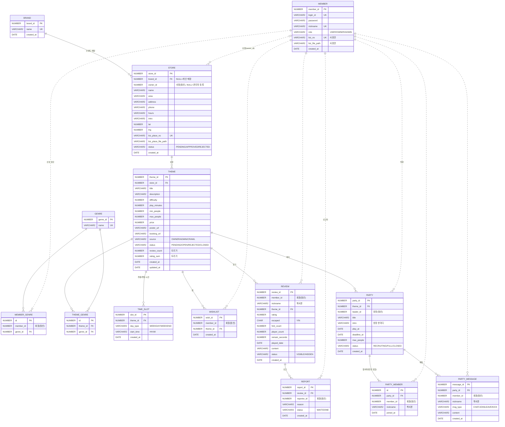
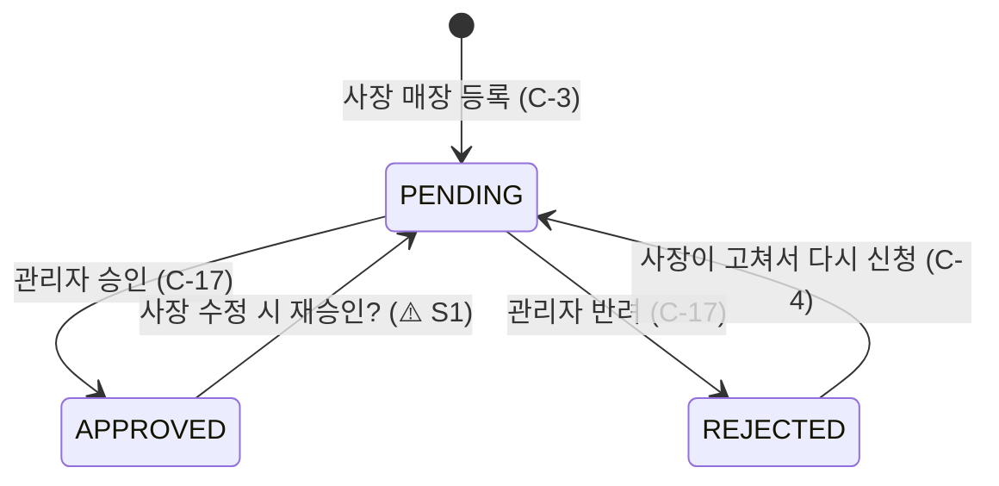
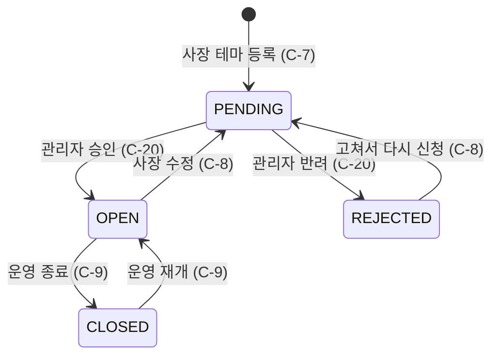
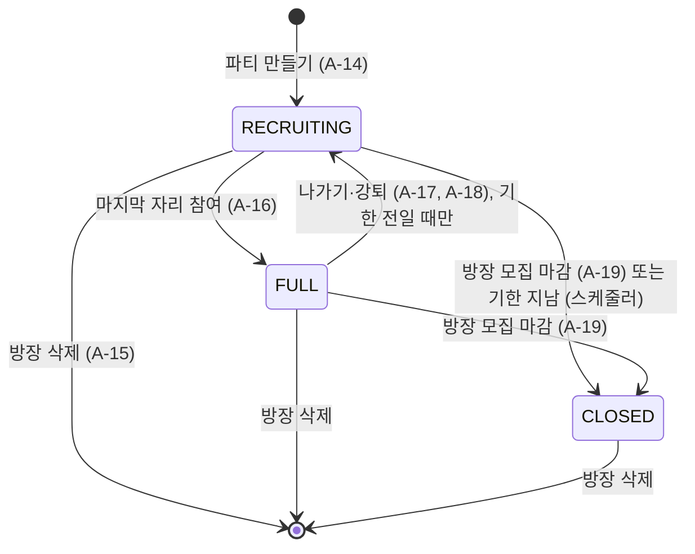

# Escaplix ERD (v3)

목업(`escaplix-mockup-repository/visualization`)에서 구현하기로 정한 기능을 기준으로 다시 정리한 데이터 구조입니다.

- 기준 자료: `sql/01_create_tables.sql`(v1, 14개 테이블), `노션_회의록_v2.md`, PM 미팅(11/17), 목업 v3 피드백 1~11번
- DB: Oracle XE 11g. `VARCHAR2` 크기는 **바이트** 단위입니다(한글 1글자 = 3바이트, `VARCHAR2(300)` = 한글 100자).
- DDL 초안: [`docs/01_create_tables_v3.sql`](01_create_tables_v3.sql). 기존 `sql/01_create_tables.sql`는 아직 바꾸지 않았습니다.
- API 명세: [`docs/API.md`](API.md)

> **표시**
> - 🆕 새로 생긴 것
> - ✏️ 바뀐 것
> - 🗑️ 없앤 것
> - ⚠️ 팀이 정해야 하는 것. 모아서 [8. 결정이 필요한 것](#8-결정이-필요한-것)에 정리했습니다.

---

## 1. 한눈에 보는 변경 (v1 → v3)

테이블은 그대로 **14개**입니다. 새로 생기거나 사라진 테이블은 없고 컬럼만 바뀝니다.

| 테이블 | 담당 | 바뀐 내용 | 근거 |
| --- | --- | --- | --- |
| MEMBER | A | 🗑️ `owner_type`(점주/본사), 🗑️ `status`(정지)<br>🆕 `biz_no`(사업자등록번호), 🆕 `biz_file_path`(사업자등록증) | 회의 v2-9 회원 정지 삭제<br>v3 피드백: 사장 하나로 통일, 가입 때 사업자등록증 첨부 |
| BRAND | C | 🗑️ `hq_id`(본사 회원) | 본사 계정이 없어짐 |
| STORE | C | 🆕 `biz_place_no`(사업장 등록번호, UNIQUE), 🆕 `biz_place_file_path`(사업장등록증), 🆕 `status`(매장 승인), 🆕 `hours`(영업시간), 🆕 `intro`(소개)<br>✏️ `phone` 필수, ✏️ `owner_id`는 관리자 등록이면 NULL | 회의 v2-4·10 매장 승인<br>v3 피드백 3: 사업장등록증, 9: 매장 상세 |
| THEME | C | 🆕 `updated_at`(수정일), 🆕 `review_count`·`rating_sum`(트리거로 계산)<br>✏️ `source`에 `ADMIN` 추가 | 회의 v2-8 생성·수정일<br>PM 미팅: 별점은 트리거, 관리자 직접 등록 |
| GENRE · THEME_GENRE | C | 그대로 | |
| TIME_SLOT | C | ✏️ 날짜별 칸(`start_at` DATE)을 **주중/주말 반복 시간표**(`day_type` + `start_time`)로 바꿈<br>🗑️ `status`(AVAILABLE/FULL) | v3 피드백 4 |
| WISHLIST | B | 그대로 | |
| REVIEW | D | 🆕 `player_count`(플레이 인원), 🆕 `remain_seconds`(남은 시간, 초 단위) | 회의 v2-6, v3 피드백 5 |
| REPORT | D | 그대로. 다만 처리 화면이 이번 범위에서 빠져 `status`는 `WAIT`로만 쌓임 | 회의 v2-6 |
| MEMBER_GENRE | D | 그대로. 이제 가입 때부터 들어감 | 회의 v2-1 |
| PARTY | A | 🆕 `intro`(방장 한마디, 100자), 🆕 `deadline_at`(모집 기한) | 회의 v2-5, v3 파티 피드백 |
| PARTY_MEMBER | A | 그대로 | |
| PARTY_MESSAGE | A | 🆕 `msg_type`(일반 채팅 / 입장 / 퇴장 / 강퇴 안내)<br>✏️ 안내 줄은 `content`가 NULL일 수 있음 | 파티 방 목업의 "○○님이 들어왔어요" |

---

## 2. ERD 다이어그램

- 실선은 진짜 FK입니다.
- **점선**은 회원번호처럼 FK 없이 번호만 저장하는 연결입니다. 서버를 2개(MSA)로 나누면 MEMBER가 다른 DB에 있기 때문이에요. 서버 1개로 확정되면 DDL 맨 아래 주석을 풀어서 진짜 FK로 바꿉니다.



### 서버별 테이블 위치 (서버 2개로 갈 때)

| 서버 | 테이블 |
| --- | --- |
| member-service (8081) | MEMBER |
| escape-service (8082) | 나머지 13개 |

서버가 2개면 escape-service는 MEMBER를 JOIN할 수 없습니다. 그래서 닉네임이 필요한 테이블(REVIEW, PARTY_MEMBER, PARTY_MESSAGE)은 닉네임을 **복사본**으로 따로 저장합니다. 이 복사본 처리는 [8번 결정 필요](#8-결정이-필요한-것) D1 항목을 보세요.

---

## 3. 테이블 상세

열 이름 뜻

| 열 | 뜻 |
| --- | --- |
| 필수 | NOT NULL이면 ✔ |
| 기본값 | DEFAULT 값 |
| 규칙 | PK/FK/UK/CHECK 등 제약조건 |

### 3-1. MEMBER — 회원 (A)

손님, 사장, 관리자를 `role` 하나로 나눕니다.
- 사장은 가입할 때 사업자등록번호와 사업자등록증 사진을 냅니다.
- 관리자 계정은 가입으로 만들 수 없고 더미 데이터로 넣습니다.

| 컬럼 | 타입 | 필수 | 기본값 | 규칙 | 설명 | 변경 |
| --- | --- | :-: | --- | --- | --- | :-: |
| member_id | NUMBER | ✔ | | PK, `sq_member` | 회원번호 | |
| login_id | VARCHAR2(30) | ✔ | | UK | 영문·숫자 아이디 | |
| password | VARCHAR2(60) | ✔ | | | BCrypt 해시(항상 60자). 응답에 절대 안 넣음 | |
| nickname | VARCHAR2(60) | ✔ | | UK | 한글 20자. 내 정보에서 바꿀 수 있음 | |
| role | VARCHAR2(10) | ✔ | | CHECK `USER`/`OWNER`/`ADMIN` | 회원 유형 | |
| biz_no | VARCHAR2(12) | | | UK | 사업자등록번호 `123-45-67890`. **사장만** 필수 | 🆕 |
| biz_file_path | VARCHAR2(500) | | | | 사업자등록증 이미지 경로(비공개 폴더). **사장만** 필수 | 🆕 |
| created_at | DATE | ✔ | SYSDATE | | 가입일 | |
| ~~owner_type~~ | | | | | 점주/본사 구분 없앰 | 🗑️ |
| ~~status~~ | | | | | 회원 정지 기능 삭제(회의 v2-9) | 🗑️ |

**CHECK `member_owner_ck`**: 사장이면 두 값이 모두 있어야 하고, 사장이 아니면 둘 다 NULL이어야 합니다.

```sql
(role = 'OWNER' AND biz_no IS NOT NULL AND biz_file_path IS NOT NULL)
OR (role <> 'OWNER' AND biz_no IS NULL AND biz_file_path IS NULL)
```

- Oracle은 한 컬럼짜리 UNIQUE에 NULL이 여러 개 있어도 허용합니다. 그래서 손님·관리자 행의 `biz_no`가 NULL이어도 UK를 걸 수 있어요.
- ⚠️ M1: 사장 계정 자체도 관리자 승인을 받아야 하면 `status`(PENDING/ACTIVE) 컬럼이 다시 필요합니다. 지금 목업은 가입 즉시 로그인되고, 승인은 매장만 받습니다.

### 3-2. GENRE — 장르 코드 (C)

| 컬럼 | 타입 | 필수 | 기본값 | 규칙 | 설명 |
| --- | --- | :-: | --- | --- | --- |
| genre_id | NUMBER | ✔ | | PK | |
| name | VARCHAR2(30) | ✔ | | UK | 공포 · 추리 · 감성 · 코믹 · 어드벤처 · SF · 잠입 (더미로 넣음) |

### 3-3. BRAND — 프랜차이즈 브랜드 (C)

| 컬럼 | 타입 | 필수 | 기본값 | 규칙 | 설명 | 변경 |
| --- | --- | :-: | --- | --- | --- | :-: |
| brand_id | NUMBER | ✔ | | PK | | |
| name | VARCHAR2(90) | ✔ | | UK | 한글 30자 (미스터리룸, 열쇠공방 …) | |
| created_at | DATE | ✔ | SYSDATE | | | |
| ~~hq_id~~ | | | | | 본사 계정 없어짐 | 🗑️ |

- ⚠️ B1: 브랜드를 누가 만드는지 정해야 합니다. 목업에는 매장 등록 화면의 브랜드 **선택칸**만 있고, 브랜드를 등록하는 화면은 없어요.
- 지금 문서는 "더미 데이터로만 넣는다"를 기준으로 썼습니다.

### 3-4. STORE — 매장 (C)

사장이 등록하면 `PENDING`입니다. 관리자가 사업장등록증을 확인하고 승인하면 `APPROVED`가 되고, 그때부터 손님에게 보이고 테마도 등록할 수 있습니다.

| 컬럼 | 타입 | 필수 | 기본값 | 규칙 | 설명 | 변경 |
| --- | --- | :-: | --- | --- | --- | :-: |
| store_id | NUMBER | ✔ | | PK | | |
| brand_id | NUMBER | | | FK → BRAND | NULL이면 개인 매장 | |
| owner_id | NUMBER | | | 점선(회원) | 등록한 사장. **관리자가 직접 등록하면 NULL** | ✏️ |
| name | VARCHAR2(150) | ✔ | | | 한글 50자 | |
| area | VARCHAR2(30) | ✔ | | | 홍대/강남/건대/신촌… 필터·지역 칩에 사용 | |
| address | VARCHAR2(300) | ✔ | | | 공개 주소 | ✏️ 필수 |
| phone | VARCHAR2(20) | ✔ | | | 매장 전화. 테마 등록·상세에 함께 보임 | ✏️ 필수 |
| hours | VARCHAR2(150) | | | | 영업시간 한 줄 `10:00 ~ 23:00 (연중무휴)` | 🆕 ⚠️S2 |
| intro | VARCHAR2(600) | | | | 매장 소개 한 줄 (한글 200자) | 🆕 ⚠️S2 |
| lat | NUMBER(9,6) | | | | 위도 (지도, 선택 기능) | |
| lng | NUMBER(9,6) | | | | 경도 | |
| biz_place_no | VARCHAR2(12) | ✔ | | UK | 사업장 등록번호. 매장마다 하나 | 🆕 |
| biz_place_file_path | VARCHAR2(500) | | | | 사업장등록증 이미지 경로(비공개 폴더) | 🆕 |
| status | VARCHAR2(10) | ✔ | `'PENDING'` | CHECK `PENDING`/`APPROVED`/`REJECTED` | 매장 승인 상태 | 🆕 |
| created_at | DATE | ✔ | SYSDATE | | 신청일 | |

**CHECK `store_file_ck`**: 사장이 등록한 매장은 사업장등록증이 꼭 있어야 합니다. 관리자가 직접 등록한 매장은 없어도 됩니다.

```sql
owner_id IS NULL OR biz_place_file_path IS NOT NULL
```

- **삭제하지 않습니다.** 테마·후기·파티가 매장을 참조하기 때문에 `status`로만 관리합니다.
- ⚠️ S1: 승인된 매장을 사장이 수정하면 다시 `PENDING`으로 돌릴지 정해야 합니다. 테마는 수정하면 다시 PENDING이에요.
- ⚠️ S2: `hours`와 `intro`는 매장 상세 목업에만 있고 매장 등록 화면에는 칸이 없어요. 쓸 거면 등록 화면에 칸을 추가하고, 안 쓸 거면 두 컬럼을 뺍니다.

### 3-5. THEME — 테마 (C)

사장이 등록·수정하면 `PENDING`입니다. 관리자가 승인하면 `OPEN`, 반려하면 `REJECTED`가 됩니다. 사장이 운영을 종료하면 `CLOSED`이고, 다시 열면 `OPEN`이에요.

| 컬럼 | 타입 | 필수 | 기본값 | 규칙 | 설명 | 변경 |
| --- | --- | :-: | --- | --- | --- | :-: |
| theme_id | NUMBER | ✔ | | PK | | |
| store_id | NUMBER | ✔ | | FK → STORE | **APPROVED 매장만** 등록 가능(서버 검사) | |
| title | VARCHAR2(150) | ✔ | | | 한글 50자 | |
| description | VARCHAR2(4000) | | | | 소개 | |
| difficulty | NUMBER(1) | ✔ | | CHECK 1~5 | 난이도 | |
| play_minutes | NUMBER(3) | ✔ | | CHECK > 0 | **제한 시간(분)**. 종료 시각·남은 시간 검사에 씀 | |
| min_people | NUMBER(2) | ✔ | | CHECK 1 ≤ min ≤ max | | |
| max_people | NUMBER(2) | ✔ | | | | |
| price | NUMBER(7) | ✔ | | CHECK ≥ 0 | 1인 가격. **인원과 상관없이 고정**(회의 v2-4) | |
| poster_url | VARCHAR2(500) | | | | 테마 사진 경로(공개 폴더). DB에는 경로만 | |
| booking_url | VARCHAR2(500) | ✔ | | | 매장 예약 사이트. `http://` 또는 `https://`로 시작(서버 검사) | |
| source | VARCHAR2(10) | ✔ | `'OWNER'` | CHECK `OWNER`/`ADMIN`/`CRAWL` | 누가 만들었나 | ✏️ ADMIN 추가 |
| status | VARCHAR2(10) | ✔ | `'PENDING'` | CHECK `PENDING`/`OPEN`/`REJECTED`/`CLOSED` | | |
| review_count | NUMBER(6) | ✔ | 0 | | 보이는(VISIBLE) 후기 수. **트리거가 관리** | 🆕 |
| rating_sum | NUMBER(8) | ✔ | 0 | | 보이는 후기 별점 합. **트리거가 관리**. 평균 = rating_sum / review_count | 🆕 |
| created_at | DATE | ✔ | SYSDATE | | 등록일. "새로 문을 연 테마" 줄에 사용 | |
| updated_at | DATE | ✔ | SYSDATE | | 수정일. 테마 정보가 바뀔 때 트리거로 갱신 | 🆕 |

- **JPA 주의**: `review_count`와 `rating_sum`은 엔티티에서 `@Column(insertable = false, updatable = false)`로 매핑합니다. 자바가 이 값을 덮어쓰면 트리거가 계산한 값이 망가져요. `updated_at`도 트리거가 넣으므로 같은 방식으로 매핑합니다.
- 평균 별점을 뽑을 때는 0으로 나누지 않게 `CASE WHEN review_count = 0 THEN NULL ELSE ROUND(rating_sum / review_count, 1) END`로 씁니다.

### 3-6. THEME_GENRE — 테마-장르 N:M (C)

| 컬럼 | 타입 | 필수 | 규칙 |
| --- | --- | :-: | --- |
| id | NUMBER | ✔ | PK |
| theme_id | NUMBER | ✔ | FK → THEME |
| genre_id | NUMBER | ✔ | FK → GENRE |
| | | | UK(theme_id, genre_id) |

테마를 등록·수정할 때 THEME과 THEME_GENRE를 **한 트랜잭션**으로 저장합니다. 수정할 때는 지우고 다시 넣습니다.

### 3-7. TIME_SLOT — 주중/주말 반복 시간표 (C)

날짜를 하나하나 넣지 않습니다. 사장은 "주중 시작 시간들"과 "주말 시작 시간들"만 등록하고, 이 시간표가 매주 똑같이 쓰입니다(v3 피드백 4).

| 컬럼 | 타입 | 필수 | 기본값 | 규칙 | 설명 | 변경 |
| --- | --- | :-: | --- | --- | --- | :-: |
| slot_id | NUMBER | ✔ | | PK | | |
| theme_id | NUMBER | ✔ | | FK → THEME | | |
| day_type | VARCHAR2(10) | ✔ | | CHECK `WEEKDAY`/`WEEKEND` | 주중(월~금) / 주말(토·일) | 🆕 |
| start_time | VARCHAR2(5) | ✔ | | CHECK `HH24:MI` 형식 | 시작 시각 `19:00` | 🆕 |
| created_at | DATE | ✔ | SYSDATE | | | 🆕 |
| | | | | UK(theme_id, day_type, start_time) | 같은 시간 두 번 금지 | ✏️ |
| ~~start_at~~ | | | | | 날짜+시간 → 위 두 컬럼으로 | 🗑️ |
| ~~status~~ | | | | | 날짜별 마감(AVAILABLE/FULL) 없앰 | 🗑️ |

- **종료 시각**은 저장하지 않고 계산합니다: `start_time + THEME.play_minutes`.
- **겹침 금지**: 같은 날 유형 안에서 두 회차의 시작 시각 차이는 `play_minutes`보다 커야 합니다. 이 검사는 서버가 합니다(C-11).
- 손님이 날짜를 고르면, 그 날짜의 요일이 월~금이면 `WEEKDAY`, 토·일이면 `WEEKEND` 시간표를 보여 줍니다.
- ⚠️ T1: 평일 공휴일을 주말로 볼지 정해야 합니다. 정하지 않으면 그냥 주중으로 나와요.
- ⚠️ T2: 특정 날짜의 특정 회차만 마감 표시하는 기능은 없어졌습니다. 필요하면 예외 테이블을 따로 둬야 해요.

### 3-8. WISHLIST — 찜 (B)

| 컬럼 | 타입 | 필수 | 기본값 | 규칙 | 설명 |
| --- | --- | :-: | --- | --- | --- |
| wish_id | NUMBER | ✔ | | PK | |
| member_id | NUMBER | ✔ | | 점선(회원) | |
| theme_id | NUMBER | ✔ | | FK → THEME | |
| created_at | DATE | ✔ | SYSDATE | | 찜한 날 (목록 최근순) |
| | | | | UK(member_id, theme_id) | 같은 테마 두 번 찜 금지 → 409 |

### 3-9. REVIEW — 후기 (D)

| 컬럼 | 타입 | 필수 | 기본값 | 규칙 | 설명 | 변경 |
| --- | --- | :-: | --- | --- | --- | :-: |
| review_id | NUMBER | ✔ | | PK | | |
| member_id | NUMBER | ✔ | | 점선(회원) | 작성자 | |
| nickname | VARCHAR2(60) | ✔ | | | 작성 당시 닉네임 복사본 | |
| theme_id | NUMBER | ✔ | | FK → THEME | | |
| rating | NUMBER(1) | ✔ | | CHECK 1~5 | 별점 | |
| escaped | CHAR(1) | ✔ | | CHECK `Y`/`N` | 탈출 성공 | |
| hint_count | NUMBER(2) | ✔ | 0 | CHECK ≥ 0 | 사용한 힌트 수 | |
| player_count | NUMBER(2) | ✔ | | CHECK ≥ 1 | **몇 명이서** 했는지 | 🆕 |
| remain_seconds | NUMBER(5) | ✔ | 0 | CHECK ≥ 0 | **남은 시간(초)**. 3분 47초 = 227. 위쪽 한계(`≤ play_minutes × 60`)는 서버 검사 | 🆕 |
| played_date | DATE | ✔ | TRUNC(SYSDATE) | | 플레이한 날 | ✏️ 기본값 |
| content | VARCHAR2(600) | | | | 한 줄 후기 (한글 200자, 안 써도 됨) | |
| status | VARCHAR2(10) | ✔ | `'VISIBLE'` | CHECK `VISIBLE`/`HIDDEN` | 숨김은 신고 처리 기능용(이번 범위 밖) | |
| created_at | DATE | ✔ | SYSDATE | | | |
| | | | | UK(member_id, theme_id) | 한 테마에 후기 하나 → 409 | |

- 화면에서는 `remain_seconds`를 `mm:ss`로 바꿔 보여 줍니다. 저장은 초 단위 정수 하나로 해요.
- 별점이 바뀌면 THEME의 `review_count`·`rating_sum`이 **트리거로 자동 반영**됩니다([5-1](#5-1-후기--테마-별점-집계-트리거)).
- ⚠️ R1: 후기 팝업 목업에는 "플레이한 날" 입력칸이 없습니다. 칸을 추가하든지, 기본값(작성한 날)을 쓰든지 정해야 해요.
- ⚠️ R2: 실패(`escaped = 'N'`)면 남은 시간 칸을 숨기고 0으로 저장할지 정해야 합니다.

### 3-10. REPORT — 후기 신고 (D)

| 컬럼 | 타입 | 필수 | 기본값 | 규칙 | 설명 |
| --- | --- | :-: | --- | --- | --- |
| report_id | NUMBER | ✔ | | PK | |
| review_id | NUMBER | ✔ | | FK → REVIEW | |
| reporter_id | NUMBER | ✔ | | 점선(회원) | 신고한 사람 |
| reason | VARCHAR2(900) | ✔ | | | 사유. 팝업에서 고른 유형 + 자세한 내용 (한글 300자) |
| status | VARCHAR2(10) | ✔ | `'WAIT'` | CHECK `WAIT`/`DONE` | |
| created_at | DATE | ✔ | SYSDATE | | |
| | | | | UK(review_id, reporter_id) | 같은 후기 두 번 신고 → 409 |

- 이번 범위는 **접수까지만**입니다(회의 v2-6). 관리자 처리 화면(S16)은 나중 기능이에요.
- ⚠️ R3: 사유를 "유형 + 자세한 내용" 한 칸에 이어 붙일지, `reason_type` 컬럼을 따로 둘지 정해야 합니다. 목업 팝업은 사실과 다름/욕설·비방/광고·도배/기타 중 하나를 고르고, 자세한 내용을 덧붙이는 모양이에요.

### 3-11. MEMBER_GENRE — 선호 장르 N:M (D)

| 컬럼 | 타입 | 필수 | 규칙 | 설명 |
| --- | --- | :-: | --- | --- |
| id | NUMBER | ✔ | PK | |
| member_id | NUMBER | ✔ | 점선(회원) | 손님만 |
| genre_id | NUMBER | ✔ | FK → GENRE | |
| | | | UK(member_id, genre_id) | |

- **손님 가입(A-1)** 때 처음 들어갑니다. 서버가 2개면 회원은 member-service, 이 테이블은 escape-service에 있어서 두 서버를 거쳐야 해요([API.md 4-2](API.md#4-2-서버-2개일-때-서버를-넘나드는-곳)).
- 수정은 마이페이지 → 내 정보 탭의 선호 장르 칸에서 합니다(D-8).
- 맞춤 추천(D-9)의 기준이 되는 데이터예요.

### 3-12. PARTY — 파티 모집 글 (A)

| 컬럼 | 타입 | 필수 | 기본값 | 규칙 | 설명 | 변경 |
| --- | --- | :-: | --- | --- | --- | :-: |
| party_id | NUMBER | ✔ | | PK | | |
| theme_id | NUMBER | ✔ | | FK → THEME | OPEN 테마만 | |
| leader_id | NUMBER | ✔ | | 점선(회원) | 방장 | |
| title | VARCHAR2(300) | ✔ | | | 제목 (한글 100자) | |
| intro | VARCHAR2(300) | ✔ | | | **방장 한마디** (한글 100자). 목록 배너·파티 방 위에 보임 | 🆕 |
| play_at | DATE | ✔ | | | 플레이 날짜+시각. 그 테마의 주중/주말 시간표에 있는 시각이어야 함 | |
| deadline_at | DATE | ✔ | | CHECK deadline_at ≤ play_at | **모집 기한** | 🆕 |
| max_people | NUMBER(2) | ✔ | | CHECK ≥ 2 | 모집 인원(방장 포함). 테마 인원 범위 안 | |
| status | VARCHAR2(12) | ✔ | `'RECRUITING'` | CHECK `RECRUITING`/`FULL`/`CLOSED` | | |
| created_at | DATE | ✔ | SYSDATE | | | |

- **현재 인원은 컬럼이 없습니다.** `PARTY_MEMBER` 줄 수를 세서 씁니다.
- 파티 목록(A-12)에는 **RECRUITING이면서 기한이 지나지 않은 파티만** 나옵니다(v3 피드백 6).
- 기한이 지난 RECRUITING 파티는 스케줄러가 CLOSED로 바꿉니다([5-3](#5-3-모집-기한-자동-마감-스케줄러)).
- 방장이 파티를 **삭제**하면 PARTY_MESSAGE → PARTY_MEMBER → PARTY 순서로 한 트랜잭션에서 지웁니다. ⚠️ P1: 지우지 않고 상태(CANCELED)로 남기는 방법도 있어요.

### 3-13. PARTY_MEMBER — 파티 참여자 (A)

| 컬럼 | 타입 | 필수 | 기본값 | 규칙 | 설명 |
| --- | --- | :-: | --- | --- | --- |
| id | NUMBER | ✔ | | PK | |
| party_id | NUMBER | ✔ | | FK → PARTY | |
| member_id | NUMBER | ✔ | | 점선(회원) | |
| nickname | VARCHAR2(60) | ✔ | | | 닉네임 복사본 |
| joined_at | DATE | ✔ | SYSDATE | | |
| | | | | UK(party_id, member_id) | 같은 파티 두 번 참여 금지 |

- **방장도 한 줄** 넣습니다. 파티를 만들 때 PARTY와 같은 트랜잭션에서 넣어요.
- 나가기와 강퇴는 줄을 지웁니다.
- ⚠️ P2: 강퇴된 사람이 다시 참여할 수 있는지 정해야 합니다. 막으려면 `kicked` 표시 컬럼이나 별도 테이블이 필요해요.

### 3-14. PARTY_MESSAGE — 파티 채팅 (A)

| 컬럼 | 타입 | 필수 | 기본값 | 규칙 | 설명 | 변경 |
| --- | --- | :-: | --- | --- | --- | :-: |
| message_id | NUMBER | ✔ | | PK | `?after=` 기준 번호(늘어나기만 함) | |
| party_id | NUMBER | ✔ | | FK → PARTY | | |
| member_id | NUMBER | ✔ | | 점선(회원) | 보낸 사람 / 안내 줄이면 그 대상 | |
| nickname | VARCHAR2(60) | ✔ | | | 복사본 | |
| msg_type | VARCHAR2(10) | ✔ | `'CHAT'` | CHECK `CHAT`/`JOIN`/`LEAVE`/`KICK` | 일반 채팅 / ○○님이 들어왔어요 / 나갔어요 / 강퇴됐어요 | 🆕 |
| content | VARCHAR2(1500) | | | CHECK `msg_type <> 'CHAT' OR content IS NOT NULL` | 한글 500자. 안내 줄은 NULL | ✏️ |
| created_at | DATE | ✔ | SYSDATE | | | |

- 안내 줄은 서버가 참여·나가기·강퇴 API 안에서 **같은 트랜잭션**으로 넣습니다.
- ⚠️ P3: 안내 줄을 저장하지 않고 화면에서만 만들 수도 있어요. 그 경우 `msg_type` 컬럼이 필요 없습니다.

---

## 4. 상태값과 바뀌는 흐름

### 4-1. STORE.status (매장 승인)



### 4-2. THEME.status



손님 화면(목록·상세·검색·추천)에는 **`THEME.status = 'OPEN'`이고 `STORE.status = 'APPROVED'`인 테마만** 나옵니다.

### 4-3. PARTY.status



### 4-4. 그 밖의 상태값

| 컬럼 | 값 | 이번 범위에서 바뀌는 곳 |
| --- | --- | --- |
| REVIEW.status | VISIBLE / HIDDEN | 없음. 숨김은 신고 처리(나중 기능) |
| REPORT.status | WAIT / DONE | 접수(D-11) 때 WAIT. DONE은 나중 기능 |
| MEMBER.role | USER / OWNER / ADMIN | 가입(A-1, A-2) 때 정해지고 바뀌지 않음 |

---

## 5. DB에서 자동으로 처리하는 것

### 5-1. 후기 → 테마 별점 집계 (트리거)

PM 미팅에서 "평균 별점과 리뷰 수는 SQL로 매번 계산하지 말고 트리거로 관리"하기로 했습니다.

- REVIEW에 넣기·별점 수정·숨김·삭제가 일어나면 THEME의 `review_count`, `rating_sum`을 더하고 뺍니다.
- 숨김(`HIDDEN`)된 후기는 집계에서 빠집니다.
- 이 트리거는 REVIEW 행 단위로 동작하고, 고치는 대상은 **THEME**입니다. 자기 테이블(REVIEW)을 다시 읽지 않으므로 ORA-04091(mutating table) 오류가 나지 않아요.
- 전제: 후기의 `theme_id`는 수정 API에서 바꿀 수 없습니다(D-2).

### 5-2. 테마 수정일 (트리거)

- THEME의 **내용 컬럼**이 바뀔 때만 `updated_at = SYSDATE`로 바꿉니다.
- 별점 트리거가 `review_count`를 고칠 때는 수정일이 바뀌지 않도록 `BEFORE UPDATE OF (내용 컬럼들)`로 걸었습니다.

### 5-3. 모집 기한 자동 마감 (스케줄러)

DB가 아니라 Spring `@Scheduled`로 합니다. 담당은 A입니다.

```sql
UPDATE party SET status = 'CLOSED'
 WHERE status = 'RECRUITING' AND deadline_at <= SYSDATE
```

- 5분마다 돌립니다(`@Scheduled(cron = "0 */5 * * * *")`).
- 스케줄러가 돌기 전 몇 분 사이에도 기한 지난 파티가 보이면 안 돼요. 그래서 목록 API와 참여 API도 `deadline_at > SYSDATE` 조건을 함께 검사합니다.

---

## 6. 파일(이미지) 저장 규칙

| 종류 | 올리는 곳 | 저장 폴더 | 공개 여부 | 경로 컬럼 |
| --- | --- | --- | --- | --- |
| 테마 사진 | 테마 등록·수정 (C-7, C-8) | `uploads/posters/` | **공개**. `/uploads/posters/**` 정적 제공 | THEME.poster_url |
| 사업자등록증 | 사장 가입 (A-2) | `private/biz/` | **비공개**. 관리자 API(A-11)로만 내려 줌 | MEMBER.biz_file_path |
| 사업장등록증 | 매장 등록 (C-3) | `private/biz-place/` | **비공개**. 관리자 API(C-16)로만 | STORE.biz_place_file_path |

- 이미지 파일 자체는 DB에 넣지 않고 경로만 저장합니다(회의 v2-10).
- 받을 수 있는 파일은 `image/jpeg`, `image/png`, `image/webp`이고 **5MB 이하**만 받습니다. 확장자만 보지 말고 실제 파일 형식도 확인해요.
- 저장할 때 파일 이름은 `UUID.확장자`로 새로 짓습니다. 올린 사람이 붙인 이름을 쓰면 경로를 조작하거나 겹치게 만들 수 있어서예요.
- 사업자등록증·사업장등록증은 개인정보라 **절대 공개 폴더에 두지 않습니다.**

---

## 7. 더미 데이터 바꿀 곳 (`sql/02_dummy_data.sql`)

v3 구조로 바꾸면 더미 데이터도 고쳐야 합니다.

- `hq1`(본사) 계정 삭제. 사장 계정(owner1, owner2)에 `biz_no`, `biz_file_path` 넣기
- `user5`(정지된 회원) 삭제(정지 기능 없음)
- BRAND의 `hq_id` 값 빼기
- STORE에 `biz_place_no`, `phone`, `status` 넣기. 승인 대기 매장 1~2개 추가(관리자 승인 화면 테스트용)
- TIME_SLOT을 날짜별 줄에서 `WEEKDAY`/`WEEKEND` + `start_time` 줄로 바꾸기
- REVIEW에 `player_count`, `remain_seconds` 넣기
- PARTY에 `intro`, `deadline_at` 넣기. 기한이 지난 RECRUITING 파티 1개(스케줄러 테스트용)
- THEME의 `review_count`·`rating_sum`은 직접 넣지 않습니다. 후기를 INSERT하면 트리거가 채워요. 단, **트리거를 먼저 만든 뒤** 후기를 넣어야 합니다.

---

## 8. 결정이 필요한 것

| 번호 | 내용 | 담당 | 이 문서가 기준으로 쓴 값 |
| --- | --- | --- | --- |
| D1 | 서버 1개 / 2개 (강사님 답변 대기) | 전체 | 2개 기준으로 점선 연결, 닉네임 복사본 유지 |
| D2 | 닉네임을 바꾸면 복사본(REVIEW, PARTY_MEMBER, PARTY_MESSAGE)도 같이 바꿀지 | A·D | 바꾸지 않음(작성 당시 이름으로 남음) |
| M1 | 사장 계정도 관리자 승인을 받을지 | A·C | 받지 않음. 매장만 승인 |
| B1 | 브랜드는 누가 만드나 | C | 더미 데이터로만. 등록 화면·API 없음 |
| B2 | 매장 상세의 "매장 예약 사이트" 버튼 링크 (매장에는 예약 링크 컬럼이 없음) | B | 그 매장 첫 테마의 `booking_url` 사용 |
| S1 | 승인된 매장을 수정하면 다시 승인 대기로 갈지 | C | 사업장 번호·등록증을 바꿀 때만 PENDING |
| S2 | 매장 영업시간·소개 컬럼을 쓸지 | B·C | 씀(NULL 허용). 매장 등록 화면에 칸 추가 필요 |
| S3 | 관리자가 직접 등록한 매장·테마를 바로 공개할지 | C | 바로 공개(매장 APPROVED, 테마 OPEN, source = ADMIN) |
| S4 | 매장·테마 반려 사유를 남길지 | C | 남기지 않음 |
| T1 | 평일 공휴일을 주말 시간표로 볼지 | B·C | 주중으로 봄(요일만 봄) |
| T2 | 특정 날짜·회차만 마감하는 기능 | C | 없음 |
| R1 | 후기 "플레이한 날" 입력 | D | 선택 입력, 비우면 작성일 |
| R2 | 실패 후기의 남은 시간 | D | 실패면 0으로 저장 |
| R3 | 신고 사유 유형을 따로 저장할지 | D | `[유형] 내용` 한 칸에 저장 |
| P1 | 파티 삭제 = 실제 삭제? 상태 변경? | A | 실제 삭제(트랜잭션) |
| P2 | 강퇴된 사람 재참여 | A | 허용(막는 데이터 없음) |
| P3 | 채팅 안내 줄을 저장할지 | A | 저장(msg_type) |
| C1 | 비회원에게 맞춤 추천 자리에 무엇을 보일지 | D | 평점 높은 OPEN 테마 5개(B-1 sort=rate) |
